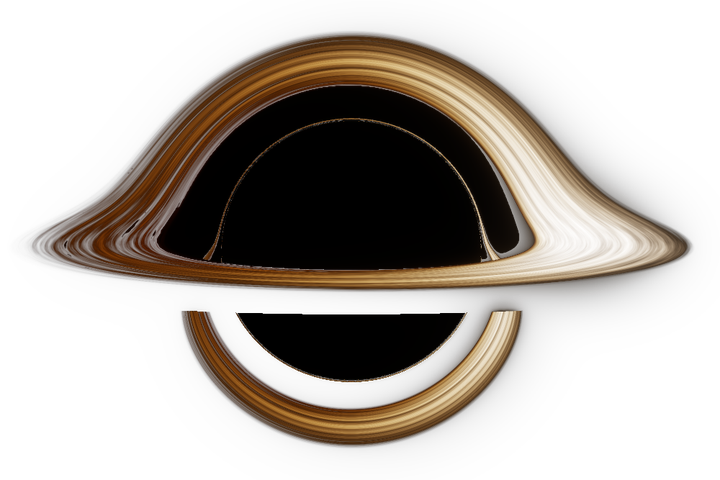
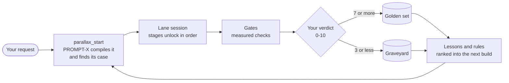
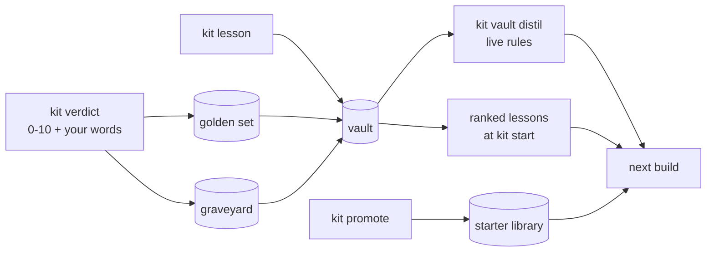

<p align="center">
  <picture>
    <source media="(prefers-color-scheme: dark)" srcset="docs/assets/parallax-logo-dark.png">
    
  </picture>
</p>

<h1 align="center">Parallax</h1>

<p align="center">Production pipelines for Roblox games, run by your AI coding agent.</p>

<p align="center">
  <a href="https://github.com/mayusi/parallax/actions/workflows/ci.yml"></a>
  <a href="https://github.com/mayusi/parallax/releases/latest"></a>
  <a href="LICENSE"></a>
</p>

<p align="center">
  <a href="https://mayusi.github.io/parallax/">Documentation</a> ·
  <a href="SETUP.md">Setup guide</a> ·
  <a href="https://mayusi.github.io/parallax/pipelines/index.html">Pipelines</a> ·
  <a href="https://mayusi.github.io/parallax/hardware.html">Hardware and models</a> ·
  <a href="https://mayusi.github.io/parallax/commands.html">Commands</a> ·
  <a href="CHANGELOG.md">Changelog</a>
</p>

## Overview

Parallax is an MCP server and a command-line kit that an AI agent drives to make a Roblox game: gameplay code, 3D
models, visual effects, animations, levels, interfaces, sound and tests. You describe what you want, the agent works
through the matching pipeline, the kit measures the result, and you give the verdict, which the kit keeps.

Three ideas set it apart from a prompt and a code generator:

- Stages are enforced. Pipeline work is refused until a session is started with your request. Each stage unlocks
  only after the one before it has left its evidence, and the stages that need your eye (a model sheet, a blockout,
  an effect's test frame, an animation's key poses) wait for your approval. The rules live in the tool, not in a text
  file an agent can ignore.
- Results are measured. Every pipeline ends in numbers: traced silhouettes against real references, motion gates
  calibrated on Roblox's own animation catalog, effect norms measured from shipped games, R6 reachability on the real
  jump arc, loudness and masking for sound, and a security audit of every remote.
- It learns from you. Your verdicts (0 to 10), approvals and rejections become a golden set, a graveyard of failed
  routes and ranked lessons that the next build must answer before it may start.

Everything runs on your machine. Every model and tool is vetted and pinned in [`VETLOG.md`](VETLOG.md), no local LLM is
needed (your AI client is the only reasoning model), any MCP client works, and the server is the authority in every
system the kit writes. Nothing is uploaded without passing the moderation gate.

The full documentation, with every stage, gate and command, is at
[mayusi.github.io/parallax](https://mayusi.github.io/parallax/).

## Quick start

Step-by-step instructions, written so an AI agent can follow them for you, are in [SETUP.md](SETUP.md). On Windows,
in PowerShell:

```powershell
git clone https://github.com/mayusi/parallax.git
cd parallax
rokit install
wally install
lune run parallax doctor
lune run parallax install ..\MyGame
cd ..\MyGame
lune run parallax connect claude
```

Use your client's name in place of `claude`: `cursor`, `vscode`, `gemini`, `roo`, `opencode`, `codex`, `windsurf`,
`cline` or `claude-desktop`. Then open the client in `MyGame` and ask for something, for example *"start the 3d lane:
a mossy stone well for the village square"*. The agent calls `parallax_start` and the lane takes it from there.

## How it works



1. You ask, in plain words, in your AI client.
2. `parallax_start` (or `lune run parallax start <lane> --prompt "..."`) compiles your words with PROMPT-X into a
   brief grounded in the repository, with up to three clarifying questions answered from the project where possible.
   It routes the brief to its case: the floor of steps it must take, the routes it may not take and the points where
   it must stop for you. Then it loads the lane's rules, the lessons ranked for this piece, the golden set, the
   graveyard, the open tasks and the last handoff.
3. Stages unlock in order. `lune run parallax plan <piece>` shows where a piece is and the next stage's commands. A
   stage's commands refuse to run until the stage before it has left its evidence and, where the lane has a lock,
   your approval.
4. Every build ends with its gates. A failing gate names the fault and the fix.
5. The kit shows you the evidence (model sheets, renders, effect players, motion sheets, listening booths, look
   stations beside their references) and records your verdict with `kit verdict <kind> <name> <0-10> "<your words>"`.
6. The verdict, your words and any lesson flow into the vault and shape the next build.

Every command ends with two lines, `summary:` (what happened) and `next_action:` (what to do next), so any model, or
you, can always continue. The work board (`kit status`) and handoffs keep the state outside the chat: switch models or
tools and the next one picks up where the last one stopped.

## Enforcement

The rules hold whatever AI client is on the other end, because they are enforced in layers that do not depend on the
agent reading anything:

| Layer | What it stops | Works with |
|---|---|---|
| MCP server gate | A pipeline tool call with no lane session; the refusal names the exact call to make first | Every MCP client |
| CLI gate | The same pipeline commands from a shell (exit 6), including the wrong lane's | Any terminal, any agent |
| Stage locks | A stage that runs before the previous stage's evidence, or before your approval | Every lane |
| Quality locks | A new piece with no real source (chart, references, brief, dossier), or a fourth new piece while three wait for your verdict | Every lane |
| Git hooks | Commits that fail format, lint or compile, break a case's contract, or mix two lanes' files | Every clone once `install`, `connect` or `harness` has run in it (git never copies hooks) |
| Client hooks | Direct edits to pipeline files outside a session | Claude Code and Gemini CLI |
| `verify` and CI | Everything else: types, tests, the security audit, every content gate | Everywhere |

Escape hatches exist for real maintenance (`--maintenance "<why>"`, `--skip-tool <tool> --why "<why>"`), and every use
is logged for your review. `lune run parallax selftest` proves the gates themselves: every content gate runs against a
bad fixture it must catch, and a gate that stops catching fails the run.

## Pipelines

| Pipeline | Lane | Builds | Measured by | You approve |
|---|---|---|---|---|
| [3D models](#3d-models) | `3d` | Weapons, props, vehicles, creatures, building pieces | Traced silhouettes, section distances, close-up fidelity, budgets | Model sheet, blockout, verdict |
| [Visual effects](#visual-effects) | `vfx` | Ultimates, beams, slashes, explosions, auras | Budgets, pro norms, on-screen share, scene match | Test frame, animatic, style sheet, verdict |
| [Animation](#animation) | `anim` | Attacks, abilities, emotes, idles, hit reactions | Planted feet, pops, hit timing, readability, collisions | Key poses, picks, verdict |
| [Worlds](#worlds) | `world` | Arenas, lobbies, obbies, towns, interiors, terrain | Reachability, traps, spawn fairness, sightlines, look lint | Direction, verdict |
| [Interfaces](#interfaces) | `ui` | HUDs, menus, shops, dialogs, status screens | Readability, touch targets, size floors, identity bans | Direction, verdict |
| [Sound](#sound) | `sfx` | Clicks, hits, explosions, weapons, loops | Loudness, clipping, masking, sync to the hit | References, booth verdict |
| [Gameplay systems](#gameplay-systems) | `code` | Server-authoritative gameplay code | Security audit, tests, fuzzing, mutation score | The brief, accepted floors |
| [QA](#qa) | `qa` | Audits, gate selftests, in-engine playtests | Console errors, a performance probe, regressions | The verdicts that become floors |

Each section below is a summary. The documentation site has every stage, gate, command and limit of each pipeline.

### 3D models

Game-ready models built in one planned pass, part by part, from real references. The stages are brief, gather, model
sheet (you approve), draft, blockout (you approve), shape, surface, mechanism, look and judge, then optimize and upload;
`lune run parallax plan <name>` unlocks one stage at a time.

- References: picture search, real-object dossiers with graded facts, patents and two measured reference models per
  asset, with local segmentation (BiRefNet, SAM 3) and similarity search (SigLIP 2, DINOv2).
- Construction: CAD on OpenCASCADE for hard surfaces (profiles, fillets, booleans, revolves, sweeps and a parts
  library of threads, beads, rings, settings, gems, chains and screws) and a picture-first route for organic parts.
  Local 3D generators (TRELLIS.2, Pixal3D, Hunyuan3D-2mv, PartCrafter) supply drafts as look targets, never the final
  mesh.
- Surfacing: scanned PBR materials, Blender bakes (normal, colour, roughness, metal), stamps, ornament relief from an
  SVG or PNG, mouldings and contact wear.
- Assembly: cloth drapes, mechanisms (joints, an action on a timeline, take-apart views), high-to-low bakes per part
  group inside a game budget, UVs by part, and CMA-ES fitting of proportions to traced reference views.

Gates: every traced view matches its reference (IoU of at least 0.9) or is excluded with a written reason; hero hard
surfaces stay within 1.5 mm of a reference model's sections; the sheet carries a picture, a sourced size and at least
2 px/mm for every hero feature; close-ups are checked at 2048 px; a prop over its triangle budget fails the build.

Known limits: some OpenCASCADE fillets fail silently on traced outlines, coplanar faces are the most common boolean
failure, and whole-object generator meshes are never accepted for a hero's hard surface.
[Full 3D reference](https://mayusi.github.io/parallax/pipelines/3d.html)

### Visual effects

Anime- and AAA-grade effects built as layered presets from a measured breakdown of real footage. The stages are
breakdown, a method plan per beat, a beat chart with one test frame (you approve), an animatic (you approve the
motion), textures, preset, play and record, a style sheet (you approve), judge and ship. Effects are built and played
in a browser player; Roblox Studio is used only to prove engine facts.

- Breakdown: a reference clip analysed frame by frame (dense timing, camera stabilisation, outline tracing) into a
  beat chart, planned against a register of 104 named effect methods. A method that a beat plans but does not use
  fails the build.
- Textures and simulation: compositing sheets, ink sheets traced from the reference, Blender recipes, and bakers for
  cloth, soft bodies, sand, hair, water, FLIP and PBF liquids and settling fracture debris, plus Geometry Nodes ripples
  and scatter and Mantaflow GPU smoke.
- Motion: particles with authored flow fields and point attractors, screen-size forcing, lens flares, chromatic
  aberration, motion-vector inbetweening, mesh shells and flipbook cards.
- Runtime: one clock for hit-stop and slow motion, composition, EditableMesh shells and a validator; a creative
  director that learns your taste from the vault, and an evolve loop that offers four variants for you to pick from.

Gates: validator budgets (layers, particle counts and rates, live particles, light range); norms measured from shipped
Roblox effects (share of non-additive layers, lifetimes, front-loaded curves, a dark twin behind every bright shape,
about five colours); the strike holds at least 3% of the hero view before its impact frames; and the effect must match
the scene's coverage, light, colour and detail before a test frame is shown.

Known limits: water does not break or spray yet, liquids are flipbook slices, the Mantaflow smoke route is not yet
proven end to end, camera stabilisation fails on flat backgrounds, and the method gate reads what a preset is made of,
not how it looks. [Full VFX reference](https://mayusi.github.io/parallax/pipelines/vfx.html)

### Animation

R6 animations authored from scratch on a procedural spring engine, calibrated against Roblox's native R6 catalog and
proven in Studio frame by frame. The stages are dossier, design (attack strings), blocking (you approve), candidates,
gates, your picks, Studio proof and verdict.

- Research: move dossiers with measured phase timings, and offline footage analysis (MediaPipe Pose) for timings,
  foot speed, hip and chest turn, pivot and lean.
- Authoring: beat script, gesture specs, pose prior and a spring engine at 60 fps, with effort sliders, arm habits,
  whip and blade planes, and an intent (calm, proper, aggressive) read from catalog tempo. Weapon movesets (one- and
  two-handed), physics hit reactions (MuJoCo) and animated props with joint ranges.
- Selection: about 2.5 gate-clean candidates are built for every one you see; the eight most different reach you,
  and your picks steer the next round.
- Repair and runtime: grip solve, collision repair, foot planting, gap filling and animated glTF export; a runtime
  with inertialization, additive layers, motion warping, matching tables, foot placement, ragdoll get-up, secondary
  motion, cutscenes and look-at.

Gates: planted feet (skate under 0.1 studs per frame), pops and seams, the hit on the striker's fastest frame,
readability, and no statues, floaty or robotic arms, jitter or frozen limbs. The weapon stays in hand, and weapon,
hands and feet are swept against the body for collisions.

Known limits: no locomotion start, stop or pivot clips yet, no steering by player input and no runtime prop player.
Roblox samples animation curves at 30 per second, so a 60 fps clip loses its odd frames.
[Full animation reference](https://mayusi.github.io/parallax/pipelines/anim.html)

### Worlds

Levels and maps built from JSON blueprints by generators, proven playable by numbers and walked in Studio. The stages
are direction (you pick), references, lessons, terrain, materials, meshes, dressing, check, look, a Studio walk and
your verdict.

- Generators: rooms, buildings, stairs, cover, paths, breakables, walls, rings, scatter, forests, ruins, towers,
  bridges, trees, palisades, peaks, dunes, cities, crosswalks and rows, plus a town planner (a square, streets,
  terraced lots on a 4-stud grid, a landmark sightline and house types).
- Terrain: shaped by rivers (stream-power incision), thermal and droplet erosion, a heightmap painter with keep masks,
  and real elevation data.
- Look: scanned CC0 materials, mesh import split to the engine's limits, streaming per step with far stand-ins, and
  look stations that render every spawn and view at 1920×1080 beside its measured reference.

Gates: R6 reachability on the real jump arc, traps, spawn fairness, camera clearance, knockback room and sightlines; a
look lint for floating or buried props, trees inside buildings and rocks on roads; town rules (no freehand town of
twelve or more buildings, declared curves and rooms); and streaming once the played part of a world exceeds 1,024
studs across.

Known limits: coloured light on water turns muddy, and yards, markets and lamps are checked for presence, not yet for
quality. [Full worlds reference](https://mayusi.github.io/parallax/pipelines/world.html)

### Interfaces

HUDs, menus, shops, death screens, status sheets and dialogs that share one identity, compiled to Rojo models,
previewed at phone, tablet and desktop sizes with the real fonts, and animated by the kit's UI runtime. The stages are
direction (you pick), identity, pieces, assembly, look (a sheet and a reel), two fresh reviewers who hunt bugs, and
your verdict.

- Identity: three to five original design directions before any screen, then an identity pack sampled from real
  references (tokens, a font trio, shape language, motion rules and bans).
- Pieces: rendered, traced, inked, lettered or spun, never a tinted font glyph standing in for art.
- Assembly: anchors, HUD size contracts measured at real screen sizes, and motion reels.
- Runtime: springs, choreographed entrances, bar ghosts and rolling counters.

Gates: the identity's bans, HUD size floors, readability, touch targets, photosensitivity (WCAG 2.3.1), craft lints
(`near_align`, `uneven_gap`, `squint`), palette checks, saliency, fuzz rendering for edge data, localisation overflow
and a regression diff against the golden version.

Known limits: taste is yours, since the model's own judge rates it lower than people do; Roblox caps text size at 100
and has no letter-spacing. [Full interfaces reference](https://mayusi.github.io/parallax/pipelines/ui.html)

### Sound

Sound effects made from real recordings layered with synthesis, in sets that share one sonic DNA, judged by you in
a listening booth and played as events by the kit's sound runtime on the Audio API. The stages are direction,
references (you pick, in the booth), identity, design, match, sheet, booth verdict, sync to the hit, runtime events and
upload.

- Direction: before any build, at least 6 references from at least 3 media, 3 pillars, and three directions that each
  differ on at least two axes (space, source, density, mood). The identity is then measured from the references you
  pick in the booth, up to three recordings per class.
- Design: layers (transient, body, sub, mechanical, tail, sweetener, air) and sets with shared DNA, weights and one
  loudness per class.
- Checking: matching against a reference, sound sheets the agent can read, an audio-video sync gate, and living
  ambience (wind voices, gusts, echo zones).

Gates: format, size, duration, loudness and clipping; takes must differ; one loudness per class (within 2 LU); heavier
is never quieter or brighter; loop seams; a hit's heaviest take drops its sub on impact within the first 150 ms, and a
swing cue leads the first active frame by 50 to 300 ms; layers that mask each other; Roblox's upload limits.

Known limits: the model cannot hear. Numbers against a reference are its only evidence, so a sound is never judged
alone. [Full sound reference](https://mayusi.github.io/parallax/pipelines/sfx.html)

### Gameplay systems

Server-authoritative Roblox code: the game skeleton, systems with pure tested rules, remotes generated from schemas,
and combat moves as data. The stages are brief, world, systems, remotes, moves, playtests and accept; a verdict of 7 or
more becomes a floor that may not regress.

- `lune run parallax game new <Name>` creates a game folder with its brief, source, work board and Rojo project.
- `lune run parallax new system <Name>` creates a Config, pure Rules, a Service, a Controller and a spec.
- `lune run parallax net` generates type-safe, rate-limited, argument-validated remotes from a schema.
- `lune run parallax move` defines moves as data (frames from the animation, hitboxes, cancels) served by a server hit
  loop.
- Fuzzing, mutation testing (at least 80% of mutants killed) and Studio playtests that fail on any console error.

Gates: the security audit (every remote argument validated and rate-limited; `require(<id>)`, `loadstring` and
`getfenv` flagged as backdoors), format, lint, types and tests, and pure shared modules in `src/shared` (no
`game:GetService`, no `Instance.new`).

Known limits: green specs are not a working game; the engine proves it, in playtests.
[Full gameplay systems reference](https://mayusi.github.io/parallax/pipelines/code.html)

### QA

Testing the way a tester works: security audits, gate selftests, scripted in-engine playtests with a performance
probe, and a regression record.

- `lune run parallax audit` finds unvalidated or unthrottled remote handlers, backdoor patterns and broadcasts in
  loops.
- `lune run parallax selftest` requires every content gate to catch its bad fixture.
- `lune run parallax playtest` drives Studio over its MCP server: play, inject the test, collect the console, stop. Any
  console error fails the run, and a performance probe checks your budget.
- `lune run parallax bug` turns every bug into a spec and a mutation case, and `lune run parallax accept` turns your
  verdicts into floors.

Known limits: Studio is shared between sessions (the kit checks its state first), an unfocused Studio window is
throttled (measured at 5 to 20 fps), and playtests need Roblox Studio installed locally with its MCP server enabled.
[Full QA reference](https://mayusi.github.io/parallax/pipelines/qa.html)

## How it learns



- Your verdict is the only quality signal. `kit verdict <kind> <name> <0-10> "<words>"` records it. A score of 7 or
  more puts the piece in the golden set; 3 or less puts its route in the graveyard, and that route is refused next time
  unless you say otherwise. A judge's score or a green gate never counts as progress on the look.
- `kit lesson <area> "..."` records a technique or a trap. `kit start --for <piece>` ranks the lessons that matter for
  the piece about to be built, and a new piece must answer them before its quality locks pass.
- After five new verdicts, `kit start` announces a distil: `kit vault distil <lane>` turns the evidence into live rules
  that you can add, edit or retire.
- The VFX and UI directors and the lanes' checks re-learn from every verdict automatically.
- `kit prompt evolve` feeds a verdict back into the prompt that produced the piece, and `kit prompt bench` replays real
  failed prompts so each keeps its guardrail.
- `kit promote <kind> <name>` adds proven work to the starter library, and `lune run parallax sync` brings the kit's
  lessons and examples into every game.

The vault (`kit/knowledge/vault`) is plain Markdown with YAML front matter and wikilinks. It reads well in Obsidian,
but the kit never depends on it.

## AI clients

Parallax is an MCP server (`kit/mcp/server.py`, Python standard library only). It sends its own rules to the client as
the server's instructions, together with every lane's full recipe, so no client needs an instruction file, a rules
folder or a copy of the skills. `lune run parallax connect <client>` adds the server to the client you use, and only
that one:

| Client | Command | Writes |
|---|---|---|
| Claude Code | `connect claude` | `.mcp.json`, plus `.claude/settings.json` with the enforcement hooks |
| Cursor | `connect cursor` | `.cursor/mcp.json` |
| VS Code (Copilot agent mode) | `connect vscode` | `.vscode/mcp.json` |
| Gemini CLI | `connect gemini` | `.gemini/settings.json`, with the enforcement hooks |
| Roo Code | `connect roo` | `.roo/mcp.json` |
| OpenCode | `connect opencode` | `opencode.json` |
| Codex CLI, Windsurf, Cline, Claude Desktop | `connect codex` (and so on) | Nothing; it prints the block to paste into the client's global config |

`connect` with no client lists them and shows what is connected, and `connect <client> --remove` takes the kit's entry
out again. Every client gets these tools:

| Tool | What it does |
|---|---|
| `parallax_start` | Start here. Loads one lane; with your request, PROMPT-X compiles it and opens the session that unlocks pipeline work |
| `parallax_prompt` | Compiles a request with PROMPT-X (cases, golden and graveyard records, a token budget per model) |
| `parallax_case` | The case a request falls in: its floor, forbidden routes, your stops and the lane's capability menu |
| `parallax_skill` | The lane's full recipe: every stage, its commands, its traps and its case table |
| `parallax_status` | The whole board: brief, tasks, the last handoff, failing gates and the next step |
| `parallax_verify` | The full quality gate |
| `parallax_help` | Every command |
| `parallax` | Runs any command; pipeline commands are refused without a session |

Clients that show MCP prompts as slash commands also get `start-<lane>` prompts.

## Uploads

`lune run parallax upload` puts everything a game needs on Roblox and records the ids where the game reads them:
textures, models and their maps, effect meshes, world meshes, interface art, sounds and animations. Only new or changed
files go, and every file is screened first by the moderation gate (banned words, blood). The Roblox Studio MCP then
sends them with your own Studio login: `upload` hands the agent the exact `open_cloud_invoke` call for each file, and
`upload --record <file> <assetId>` stores each id. No key is created, typed or stored. You grant the scopes once per
game in Studio (see [SETUP.md](SETUP.md#step-6-roblox-studio-and-its-mcp-server)). For headless runs such as CI, a
`ROBLOX_API_KEY` in the environment still works.

## Common commands

`kit` is short for `lune run parallax` (`lune run kit` is the same command).

| Command | What it does |
|---|---|
| `lune run parallax status` | The board: brief, tasks in progress, last handoff, failing gates, next step |
| `lune run parallax start <lane> --prompt "<request>"` | Starts a lane session (the same as `parallax_start`) |
| `lune run parallax plan <piece>` | Where a piece is, and the next stage's commands |
| `lune run parallax approve <lane> <name> "<words>" --by owner` | Records your approval of a locked stage |
| `lune run parallax verdict <kind> <name> <0-10> "<words>"` | Records your verdict |
| `lune run parallax verify` | The full quality gate |
| `lune run parallax selftest` | Proves every gate still catches its bad fixture |
| `lune run parallax upload` | Screens and uploads new or changed assets |
| `lune run parallax handoff "<what>" --lane <lane> --next "<what next>"` | Ends a session for the next model or person |
| `lune run parallax connect <client>` | Connects an AI client |
| `lune run parallax doctor` | Checks every tool and reports your machine's hardware tier |
| `lune run parallax vision setup [--tier core\|vision\|gen\|all]` | Fetches the vetted local models for a tier (`--list` shows sizes) |
| `lune run parallax upgrade [--check]` | Updates the kit in a game from the latest GitHub release |
| `lune run parallax help --all` | Everything else |

`--by owner` is literal: it marks the approval as yours, as the person who owns the game.

## Hardware tiers

Parallax runs on any PC and grows with your hardware. Each tier includes everything below it, and a missing tier never
breaks a lower one: the lane takes the route your tier allows and says so. `lune run parallax doctor` reports which
tier your machine reaches and what the next one needs.

| Tier | Hardware | You install | Download | Unlocks |
|---|---|---|---|---|
| 0 (zero-GPU core) | Any Windows PC, no GPU, 4 GB RAM | Rokit's toolchain, Python 3.11 (numpy, scipy, Pillow, matplotlib, pytest), Node.js, ffmpeg | Under 0.5 GB | PROMPT-X, the board and gates, `verify`, `test` and `selftest`, the security audit, gameplay systems and remotes, the UI compiler, sound synthesis and its booth, world checks, uploads, and Studio playtests (with Roblox Studio and its MCP server) |
| 1 (DCC and CAD) | Any CPU or an entry GPU, 8 GB RAM | Blender 5.2, then `tools setup kit-python`, `tools setup cad` and `tools setup mitsuba` | About 2 GB | 3D modelling (CAD, procedural, bakes), Cycles renders, UI 3D plates, animation bakes, world look stations |
| 2 (light vision core) | The CPU (`KIT_FORCE_CPU=1`) or any 4 GB GPU, 8 to 16 GB RAM | PyTorch (with torchvision), transformers and safetensors in the kit's Python, then `vision setup` for the core models (SAM 2.1, Depth Anything V2, BiRefNet, TEED, SigLIP 2, DINOv2, Real-ESRGAN) | 2.43 GB | Cut-outs, depth, edges, similarity search, traced references, part masks by point or box, 4× upscaling |
| 3 (local VLM and diffusion) | An NVIDIA GPU with 12 GB of VRAM, 16 GB RAM | `vision setup --tier vision` (Qwen3-VL-4B, Depth Anything 3, MoGe-2, Marigold-IID, SDXL, FLUX.2 klein, SAM 3), plus the hand-built `diffusers` and TRELLIS.2 environments from [`kit/gen/README.md`](kit/gen/README.md) | 44.58 GB more | Local reference reading (Qwen3-VL-4B, 8.89 GB), relief, normal and albedo from photos, HDRI lighting probes, concept and plate generation |
| 4 (full 3D generation) | CUDA 13, 12 to 16 GB or more of VRAM, 32 GB RAM, Windows with MSVC 2022 | `vision setup --tier gen` (Qwen-Image-Edit and its runner, stable-diffusion.cpp) and the 3D generators' environments from [`kit/gen/README.md`](kit/gen/README.md) | About 24.5 GB of models, plus 25 to 70 GB of generator environments | Single- and multi-view 3D drafts (TRELLIS.2, Pixal3D, Hunyuan3D-2, PartCrafter), new-angle image edits, photogrammetry, retopology, convex hulls |

No local LLM is needed: your AI client does all the reasoning. The only local model that reads pictures and answers
questions about them is Qwen3-VL-4B (Tier 3), which lists the details of a reference and reads engraved text. Without
it, the kit hands your client the pictures with exact questions to answer and records the answer.

`lune run parallax vision setup --list` prints every model with its tier and size. The Tier 4 generators are opt-in,
and each comes under its own licence; some restrict territories or uses, so read [`VETLOG.md`](VETLOG.md) before you
install one. [SETUP.md](SETUP.md#step-5-choose-your-hardware-tier) walks through each tier.

### Optional services

None of these is required; each one switches a feature on.

| Service | How | Without it |
|---|---|---|
| Roblox Studio's MCP server | Studio's own settings (no key) | No playtests or uploads; every offline compiler and gate still runs |
| Hugging Face gated models (SAM 3, DINOv3) | Your own access and `HF_TOKEN` in your environment | The free SAM 2.1 point and box masks stand in; the Tier 4 encoder is not fetched |
| Sketchfab reference models | `SKETCHFAB_API_TOKEN` | Search still works; downloads fall back to Poly Haven, Smithsonian and ambientCG |
| Public reference sources (Openverse, Wikimedia, museums, Poly Haven, USGS and others) | None | A tool that cannot reach one skips it with a structured note |
| Headless uploads (CI) | `ROBLOX_API_KEY` in the environment | Uploads go through the Studio MCP instead |

There are no cloud AI APIs anywhere in the kit. Where a local VLM would judge something (a design review against its
bans and pillars, screening a design exploration's candidates, reading the text in a reference) and Tier 3 is not
installed, the kit hands your AI client a packet instead: the pictures and a `PROMPT.md` with the exact questions. It
records the answer with `--record`, and nothing unscreened moves on until it does.

## Project layout

```
parallax/
├── kit/                 the kit: commands (cmd/), libraries (lib/), Python tools, the MCP server (mcp/),
│                        lane recipes (skills/), cases and the knowledge vault (knowledge/), selftest fixtures
├── src/kit/             the in-game runtime your game requires (VFX, UI, sound, animation, worlds, networking)
├── assets/              the measured data the builders read (animation calibration, the R6 rig, effect norms)
├── site/                the documentation site published at mayusi.github.io/parallax
├── parallax.luau        the entry point: lune run parallax <command>
├── rokit.toml           the pinned toolchain       wally.toml / wally.lock   the pinned packages
└── docs/                the logo and documentation assets
```

`lune run parallax install <path>` copies the kit into a game folder. Inside a game, `lune run parallax upgrade`
installs the latest GitHub release: it checks the SHA-256, makes a backup first, replaces the kit's code (files you
added under `kit/` stay), only adds to starter content and lessons, merges the knowledge vault while keeping your own
lessons and verdicts, and leaves your game's code and content alone. From a local clone, `lune run parallax sync`
(inside a game) or `lune run parallax update <path>` (here) copies the kit in from your clone instead, with no
download, checksum or backup. Neither takes a game back to an older kit than the one it holds unless you add `--force`.

## Roadmap

Planned, in no fixed order:

- Other engines: Godot first, then Unreal Engine and Unity. About 70% of the kit is already engine-agnostic, and much
  of what the pipelines make is engine-neutral (FBX and glTF models, baked PBR maps, glTF animation, OGG sound). Each
  engine gets nine drivers (assets, scenes, animation, materials, audio, the engine bridge, code, publishing and a
  runtime SDK) behind the same MCP server and gates. A project already names its engine in `kit.config.json`
  (`"engine": "roblox"`); the architecture is in [docs/ENGINES.md](docs/ENGINES.md).
- macOS and Linux as first-class platforms.
- A one-step install of the MCP server.
- The known limits listed above: locomotion clips and input steering, water that breaks and sprays, a proven smoke
  route, a runtime prop player, and quality checks for town dressing.
- Opt-in sharing of lessons and golden sets between projects and teams.

Ideas and requests are welcome in the issues.

## Status

Version 3.1.0 is the current release (November 2026), Windows first. The kit's own tests: more than 1,900 Luau specs,
more than 5,000 Python tests, and a selftest in which every content gate must catch its bad fixture.

## Contributing, security and license

- Working on the kit itself: [CONTRIBUTING.md](CONTRIBUTING.md). Changes: [CHANGELOG.md](CHANGELOG.md). Design
  decisions: [DECISIONS.md](DECISIONS.md). Community standards: [CODE_OF_CONDUCT.md](CODE_OF_CONDUCT.md).
- Security model and reporting: [SECURITY.md](SECURITY.md). Every tool, model and dataset the kit downloads is vetted
  from two sources in [VETLOG.md](VETLOG.md).
- Released under the MIT License; see [LICENSE](LICENSE). Copyright (c) 2026 mayusi. Third-party components keep their
  own licences: [THIRD_PARTY_NOTICES.md](THIRD_PARTY_NOTICES.md).

Parallax is an independent project and is not affiliated with or endorsed by Roblox Corporation.
