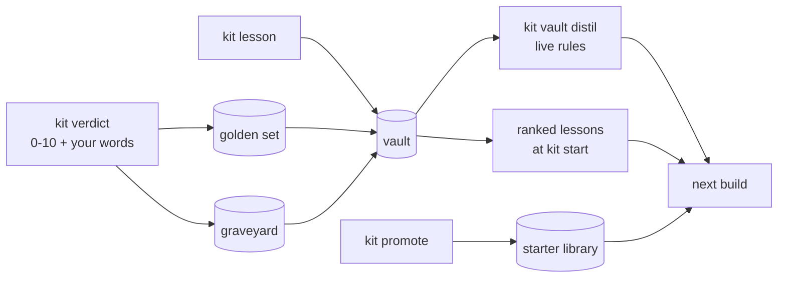

<p align="center">
  
</p>

<h1 align="center">Parallax</h1>

<p align="center">
  <b>Turn your AI coding agent into a Roblox game studio.</b><br>
  Eight production pipelines - 3D, VFX, animation, worlds, UI, sound, gameplay systems and QA - served as an MCP tool,
  with stages that cannot be skipped, gates that measure, and a knowledge vault that learns from every verdict you give.
</p>

<p align="center">
  <a href="https://github.com/mayusi/parallax/actions/workflows/ci.yml"></a>
  <a href="https://github.com/mayusi/parallax/releases"></a>
  <a href="LICENSE"></a>
  
  
</p>

<p align="center">
  <a href="https://mayusi.github.io/parallax/"></a>
  <a href="https://mayusi.github.io/parallax/setup.html"></a>
  <a href="https://mayusi.github.io/parallax/hardware.html"></a>
  <a href="https://mayusi.github.io/parallax/pipelines/index.html"></a>
  <a href="https://mayusi.github.io/parallax/commands.html"></a>
  <a href="https://mayusi.github.io/parallax/roadmap.html"></a>
</p>

<p align="center">
The documentation site at <a href="https://mayusi.github.io/parallax/">mayusi.github.io/parallax</a> has more depth: the stages, gates and commands of every pipeline, and the hardware setup walkthrough.
</p>

<p align="center">
  <a href="SETUP.md"><b>Setup guide</b></a> ·
  <a href="#how-it-works"><b>How it works</b></a> ·
  <a href="#the-pipelines"><b>The pipelines</b></a> ·
  <a href="#hardware-tiers"><b>Hardware tiers</b></a> ·
  <a href="#how-it-gets-better"><b>How it gets better</b></a> ·
  <a href="#roadmap"><b>Roadmap</b></a>
</p>

---

## What Parallax is

Parallax is an **MCP server and a command-line kit** that an AI agent drives to make a Roblox game: gameplay code,
3D models, visual effects, animations, levels, interfaces, sound and tests. You say what you want; the agent works
through that pipeline's stages; the kit measures every result; **you** give the verdict - and the kit remembers it.

Most AI game tooling is a prompt and a hope. Parallax is built on three different ideas:

- **Enforced, not advisory.** Pipeline work is refused until a lane session is started with your request. Each stage
  unlocks only when the one before it produced its evidence, and the stages that need your eye (a model sheet, a
  blockout, an effect's test frame, an animation's key poses) wait for your approval. The rules live in the tool, not
  in a text file an agent can ignore.
- **Measured, not guessed.** Every pipeline ends in numbers: traced silhouettes against real references, motion
  gates calibrated on Roblox's own animation catalog, effect norms measured from shipped games, R6 reachability on the
  real jump arc, loudness and masking for sound, a security audit for every remote.
- **It learns from you.** Your verdicts (0-10), your approvals and your rejections become the golden set, the
  graveyard and ranked lessons that the next build must answer before it may start.

It is **local-first** (every model and tool runs on your machine, vetted and pinned in [`VETLOG.md`](VETLOG.md)),
**needs no local LLM** (your AI client is the only reasoning model; local vision models are optional
[hardware tiers](#hardware-tiers)), works with **any MCP client**, and is **safe by default**: the server is the
authority in every system it writes, and nothing it uploads leaves without passing its moderation gate.

## Quick start

Full step-by-step instructions - written so an AI agent can follow them for you - are in **[SETUP.md](SETUP.md)**.

```powershell
git clone https://github.com/mayusi/parallax.git
cd parallax
rokit install
wally install
lune run parallax doctor
lune run parallax install ..\MyGame
cd ..\MyGame
lune run parallax connect claude
```

Use your client's name in place of `claude`: `cursor`, `vscode`, `gemini`, `roo`, `opencode`, `codex`, `windsurf`,
`cline` or `claude-desktop`. Then open the client in `MyGame` and ask for something - *"start the 3d lane: a mossy
stone well for the village square"*. The agent calls `parallax_start`, and the lane takes it from there.

## How it works


1. **You ask.** In plain words, in your AI client.
2. **The lane starts.** `parallax_start` (or `lune run parallax start <lane> --prompt "..."`) compiles your words with
   **PROMPT-X** into a repo-grounded brief - up to three clarifying questions, answered from the project where it
   can - and routes it to its **case**: the floor of steps it must take, the routes it may not take, and the points
   where it must stop for you. It loads the lane's boot sheet: its rules, the lessons ranked for this piece, the
   golden set, the graveyard, the open tasks and the last handoff.
3. **Stages unlock in order.** `lune run parallax plan <piece>` shows where a piece is and the next stage's commands.
   A stage's commands refuse to run until the stage before it left its evidence - and, where the lane has a lock,
   your approval (`kit approve`).
4. **Gates measure.** Every build ends with its gates. A failing gate names the fault and the fix.
5. **You look and decide.** The kit shows you the evidence - model sheets, renders, effect players, motion sheets,
   listening booths, look stations beside their references - and records your verdict:
   `kit verdict <kind> <name> <0-10> "<your words>"`.
6. **The kit learns.** The verdict, your words and any lesson flow into the vault and shape the next build.

Every command ends with two lines - `summary:` (what happened) and `next_action:` (exactly what to do next) - so any
model, or you, can always continue. The work board (`kit status`) and handoffs mean nothing lives only in a chat:
switch models or tools and the next one picks up where the last one stopped.

## Enforced, not advisory

The rules hold whatever AI client is on the other end, because they are enforced in layers that do not depend on the
agent reading anything:

| Layer | What it stops | Works with |
|---|---|---|
| **MCP server gate** | a pipeline tool call with no lane session (the refusal names the exact call to make first) | every MCP client |
| **CLI gate** | the same pipeline commands from a shell (exit 6) - including the wrong lane's | any terminal, any agent |
| **Stage locks** | a stage that runs before the previous stage's evidence, or before your approval | every lane |
| **Quality locks** | a new piece with no real source (chart, references, brief, dossier), or a fourth new piece while three wait for your verdict | every lane |
| **Git hooks** | commits that fail format, lint or compile, break a case's contract, or mix two lanes' files | every clone once `install`, `connect` or `harness` has run in it (git never copies hooks) |
| **Client hooks** | direct edits to pipeline files outside a session (Claude Code, Gemini CLI) | clients that run hooks |
| **`verify` and CI** | everything else: types, tests, the security audit, every content gate | everywhere |

Escape hatches exist for real maintenance (`--maintenance "<why>"`, `--skip-tool <tool> --why "<why>"`) and every
use is logged for your review. `lune run parallax selftest` proves the gates themselves: every content gate is run
against a bad fixture it must catch, and a gate that stops catching fails the run.

## The pipelines

| Lane | Makes | Measured by | You approve |
|---|---|---|---|
| [**3D**](#3d-models) `3d` | weapons, props, vehicles, creatures, building pieces | traced silhouettes, section distances, close-up fidelity, budgets | model sheet, blockout, verdict |
| [**VFX**](#visual-effects) `vfx` | ultimates, beams, slashes, explosions, auras | budgets, pro norms, on-screen share, scene match | test frame, animatic, style sheet, verdict |
| [**Animation**](#animation) `anim` | attacks, abilities, emotes, idles, hit reactions | planted feet, pops, hit timing, readability, collisions | key poses, picks, verdict |
| [**Worlds**](#worlds) `world` | arenas, lobbies, obbies, towns, interiors, terrain | reachability, traps, spawn fairness, sightlines, look lint | direction, verdict |
| [**UI**](#interfaces) `ui` | HUDs, menus, shops, dialogs, status screens | readability, touch targets, size floors, identity bans | direction, verdict |
| [**Sound**](#sound) `sfx` | clicks, hits, explosions, weapons, loops | loudness, clipping, masking, sync to the hit | references, booth verdict |
| [**Systems**](#gameplay-systems) `code` | server-authoritative gameplay code | security audit, tests, fuzzing, mutation score | the brief, accepted floors |
| [**QA**](#qa) `qa` | audits, gate selftests, in-engine playtests | console errors, a performance probe, regressions | the verdicts that become floors |

### 3D models

Game-ready models built in one planned pass, part by part, from real references.

**What it can do**
- Gather real references: picture search, real-object dossiers with graded facts, patents, and two measured
  reference models per asset; local segmentation (BiRefNet, SAM 3) and similarity search (SigLIP 2, DINOv2).
- Draft with local 3D generators (TRELLIS.2, Pixal3D, Hunyuan3D-2mv, PartCrafter) - as look targets, never as the
  final mesh.
- Build hard surfaces with CAD on OpenCASCADE (profiles, fillets, booleans, revolves, sweeps, soft or crisp edge
  roles, a parts library of threads, beads, rings, settings, gems, chains and screws) and organic parts by a
  picture-first route.
- Surface with scanned PBR materials and Blender bakes (normal, colour, roughness, metal), stamps, ornament relief
  from an SVG or PNG, mouldings and contact wear.
- Cloth drapes, mechanisms (joints, an action on a timeline, take-apart views), high/low bakes per part group inside a
  game budget, UVs by part, and CMA-ES auto-fitting of proportions to traced reference views.

**How it works** - brief → gather → model sheet *(you approve)* → draft → blockout *(you approve)* → shape → surface →
mechanism → look & judge → optimize & upload. `lune run parallax plan <name>` unlocks one stage at a time.

**Gates** - every traced view matches its reference (IoU ≥ 0.9) or is excluded with a written reason; hero hard
surfaces stay within 1.5 mm of a reference model's sections (this 1.5 mm rule applies to hero hard surfaces only);
the sheet carries a picture, a sourced size and at least 2 px/mm for every hero feature; close-ups are checked at 2048 px;
a prop over its triangle budget fails the build; `texel_bar` (blurrier than 1 texel = 1 screen pixel at 1028 px/m hero,
257 px/m prop) is a warning, not a build error.

**It learns** from its graveyard (a failed route is refused without your word), from ranked lessons a route change
must answer, and from a per-asset study the kit requires before a new piece starts.

**Known limits** - some OpenCASCADE fillets fail silently on traced outlines, and coplanar faces are the commonest
boolean failure; whole-object generator meshes are never accepted for a hero's hard surface.

<details><summary><b>Stages, gates, commands and limits</b></summary>

| Stage | What happens | You approve? |
|---|---|---|
| brief | Define the asset, tier (= budget), hero features, parts plan with one route per part | No |
| gather | Dossier (approved facts, sourced size), two reference models graded, every traced part looked at, then a study: each reference read, our version decided, vault lessons answered | No |
| sheet | Model sheet drawn (every hero feature has a picture box, sourced size, ≥ 2 px/mm); skipped for props | YES - before any generator run |
| draft | 3D generators per organic part only (never hard surface on hero); topology and side-check pass | No |
| blockout | Big shapes only (clay), blockout sheet drawn from a shape round | YES - before any detail or bake |
| shape | Every traced view matched (IoU ≥ 0.9) or excluded with written reason; hero hard-surface sections ≤ 1.5 mm vs a reference model; every part made by its planned method | No |
| surface | Material per part with sourced data; markings engraved at measured places; wear from use; `texel_bar` is a warning | No |
| mechanism | Hero only: joint travel without collision; action cycle on the timeline; disassembly view | No |
| look & judge | Verifier: same crop of reference and render per view; up to 10 rounds, then your verdict | YES - your verdict |
| ship | Game version (`lune run parallax optimize`), Studio spawn, public asset upload; `lune run parallax promote` only on verdict ≥ 7 | No |

**Key gates:**
- Blocking errors: ≤ 20k tris per mesh; closed mesh; UVs present; no floating parts; size within design; no inside-out faces; `cad_solid` (every CAD part a valid, closed solid); every `a.expect` passes; stage lock (hero: every traced view at bar before detail judged); coverage (hero: each hero feature ≥ 2 px/mm in some picture); `pbr_values` (hero)
- Warnings: buried parts; `texel_bar` (blurrier than the tier's texel floor); `texture_roblox` (map above 4096); palette; symmetry; coverage and `pbr_values` on props

**Commands:**
```
lune run parallax start 3d --prompt "<request>"
lune run parallax plan <name>
lune run parallax make <name> "<object>" --tier prop
lune run parallax sheet <name>
lune run parallax blockout <name>
lune run parallax approve 3d <name> "<words>" --by owner --stage sheet|blockout
lune run parallax asset <name> [--geo] [--geo --only <part>]
lune run parallax judge <name>
lune run parallax verdict asset <name> <0-10> "<words>"
lune run parallax optimize <name>
lune run parallax study <name> --new
lune run parallax refs expand|find|dims|patent|coverage
lune run parallax vision plate|cutout|upscale|albedo
lune run parallax gen views|gen parts
lune run parallax cad check [--only <Part>]
```

**Tools and tiers:** Blender 5.2 (Tier 1+); OpenCASCADE via `a.cad` (Tier 1+); local 3D generators TRELLIS.2, Pixal3D, Hunyuan3D-2mv, PartCrafter (Tier 4 only); vision models SAM 2.1, BiRefNet, TEED, SigLIP 2, DINOv2, Real-ESRGAN (Tier 2+), Qwen3-VL, SAM 3 (Tier 3+); Studio MCP for uploads and showcase.

**Known limits:** some OpenCASCADE fillets fail silently on traced outlines; coplanar faces are the commonest boolean failure; whole-object generator meshes are never accepted for a hero's hard surface; generated turned views are unreliable for thickness (measured sections needed).

</details>

[Full 3D pipeline reference](https://mayusi.github.io/parallax/pipelines/3d.html)

---

### Visual effects

Anime- and AAA-grade effects built as layered presets from a measured breakdown of real footage, judged in a browser
player.

**What it can do**
- Break a reference clip down frame by frame - dense timing, camera stabilisation, outline tracing - into a beat chart.
- A register of 104 named effect methods: every beat states which methods it uses, and a planned method that is not
  used fails the build.
- Textures from compositing sheets, ink sheets traced from the reference, and Blender recipes.
- Simulation bakers: cloth, soft bodies, sand, hair, water, FLIP and PBF liquids and fracture debris that settles (the
  kit's own Python), Geometry Nodes ripples and scatter (Blender), Mantaflow GPU smoke.
- Particles with authored flow fields and point attractors, screen-size forcing, lens flares, chromatic aberration and
  motion-vector inbetweening; mesh shells (flame, tongue, spiral, bolt) and flipbook cards.
- A runtime with one clock for hit-stop and slow motion, composition, EditableMesh shells and a validator.
- A creative director that learns your taste from the vault, and an evolve loop: four variants, you pick.

**How it works** - breakdown → method plan per beat → beat chart with one test frame *(you approve)* → animatic
*(you approve the motion)* → textures → preset → play and record → style sheet *(you approve)* → judge → ship.
Effects are built and played in a
browser player; Roblox Studio is used only to prove engine facts, not to build effects.

**Gates** - validator budgets (layers, particle counts and rates, live particles, light range); pro norms measured
from shipped Roblox effects (share of non-additive layers, lifetimes, front-loaded curves, a dark twin behind every
bright shape, about five colours); the strike holds at least 3% of the hero view before its impact frames; and the
effect must match the scene's coverage, light, colour and detail before a test frame is shown.

**It learns** - every graveyard route becomes a gate on the real piece; the director re-distils your taste after
every verdict; your named faults become selftest fixtures.

**Known limits** - water does not break or spray yet; liquids are flipbook slices; the Mantaflow smoke route is not
yet proven end to end; camera stabilisation fails on flat backgrounds; the method gate reads what a preset is made of,
not how it looks - a planned method used badly still passes.

<details><summary><b>Stages, gates, commands and limits</b></summary>

| Stage | What happens | You approve? |
|---|---|---|
| breakdown | Frame-by-frame scene analysis, camera stabilisation, outline tracing, measured beat sheet with hold/slow-mo marks | No |
| method plan | 104 named methods assigned beat-by-beat, written before the chart is shown; a planned method with no layer proof in that beat is refused | Approved with the chart |
| chart | Beat chart on the clock with one test frame of the key beat; the method plan drawn under each beat | YES - before any full version |
| animatic | Motion as flat shapes on the chart's timing, measured against the plan, laid beside the scene | YES - before textures |
| textures | Compositing sheets, ink sheets traced from reference, Blender recipes | No |
| preset | Layer-stack preset (`assets/effects/<name>.json` v3); fracture, cloth, soft-body, sand, hair, Geometry Nodes, water, FLIP, field, points, dissolve as needed | No |
| play | Browser player, recorded; daily loop outside Studio | No |
| style sheet | After a recorded play: every beat's look as a pair, the scene's frame beside ours, with what falls short in words | YES - `lune run parallax approve vfx <effect> "<words>" --by owner --stage style` |
| judge | Scene frame vs render per beat, one difference and one edit; evolve loop: four variants, you pick | YES - your pick and your verdict |
| ship | Vault check green; `lune run parallax promote vfx` only on verdict ≥ 7 | No |

**Key gates:**
- Blocking: ≤ 150 layers; particle count ≤ 200; rate ≤ 400; lifetime ≤ 20 s; flipbook fps ≤ 30; about 1,500 live particles (warning at 800); light range ≤ 60; everything ends by `duration`
- Method gate: beat with no plan refused; planned method with no layer proof in that beat refused; a method used badly still passes (the gate reads structure, not look quality)
- Pro norms (checks): about 44% non-additive layers; lifetimes about 0.58 s; front-loaded curves; dark twin behind every bright shape; about 5 colours; strike ≥ 3% of hero view before impact frames
- Legacy keys (errors on new pieces): `spreadAngle`, `fov` on fov layers, shake `frequency`, big opaque camera-facing card on ground

**Commands:**
```
lune run parallax start vfx --prompt "<request>"
lune run parallax new vfx <snake> [--from hit_sparks]
lune run parallax vfx breakdown <set> --clip <file> --fps 2
lune run parallax vfx breakdown <set> --dense
lune run parallax vfx trace <set> --beat N [--box ...]
lune run parallax vfx chart <set>
lune run parallax vfx chart <set> --approve "<words>" --by owner
lune run parallax vfx stylesheet <effect>
lune run parallax vfx methods
lune run parallax vfx methods --set <set> --beat N --use id,id
lune run parallax vfx animatic <set>
lune run parallax vfx comp <key> --new ring|skin|...
lune run parallax vfx ink <key> --from ...
lune run parallax vfx <name>
lune run parallax vfx play <name> [--record]
lune run parallax vfx judge <name>
lune run parallax vfx evolve <name>
lune run parallax vfx vault find|get|verdict|check
lune run parallax verdict vfx <name> <0-10> "<words>"
lune run parallax promote vfx <name>
# Simulation tools (the kit's Python; geonodes needs Blender, Tier 1+):
lune run parallax vfx fracture|cloth|soft|sand|hair|geonodes|water|liquid|field|points|dissolve
```

**Tools and tiers:** Blender 5.2 (Tier 1+, texture recipes, Geometry Nodes bakes); browser player using three.js (Tier 0; any browser with WebGL); Studio MCP for engine-fact probes only; BiRefNet for silhouette tracing (Tier 2+).

**Known limits:** water does not break or spray yet; liquids are flipbook slices; Mantaflow smoke route not yet proven end to end; camera stabilisation fails on flat backgrounds; Studio ignores EditableMesh vertex alpha and TextureID alpha (mesh dissolve must use baked flipbook, not `erode`); particles do not draw EditableImage textures (accepted but invisible); an unfocused Studio window is throttled (measured at 5-20 fps); the method gate reads structure, not look quality.

</details>

[Full VFX pipeline reference](https://mayusi.github.io/parallax/pipelines/vfx.html)

---

### Animation

Measured R6 animations authored from scratch on a procedural spring engine, calibrated against Roblox's native R6
catalog and proven in Studio frame by frame.

**What it can do**
- Move dossiers with measured phase timings; offline footage analysis (MediaPipe Pose) for timings, foot speed, hip
  and chest turn, pivot and lean.
- A procedural engine - beat script → gesture specs → pose prior → spring engine at 60 fps - with effort sliders, arm
  habits, whip and blade planes, and an intent (calm, proper, aggressive) read from catalog tempo.
- Weapon movesets (one- and two-handed), physics hit reactions (MuJoCo), animated props with joint ranges.
- Blocking sheets of key poses, a design page for attack strings, timing charts, and gallery tuning: about 2.5×
  gate-clean candidates are built, the eight most different are shown, and your picks steer the next round.
- Repairs (grip solve, collision repair, foot planting, gap filling) and animated glTF export.
- A runtime: inertialization, additive layers, motion warping, matching tables, foot placement, ragdoll get-up,
  secondary motion, cutscenes and look-at.

**How it works** - dossier → design (attack strings) → blocking *(you approve)* → candidates → gates → your picks →
Studio proof → verdict.

**Gates** - planted feet (skate under 0.1 studs per frame), pops and seams, the hit on the striker's fastest frame,
readability, no statues, floaty or robotic arms, no jitter or frozen limbs; the weapon stays in hand; weapon, hands and
feet are swept against the body for collisions.

**It learns** - your picks and rejections steer the next gallery; the golden set is the calibration source; rejected
clips become gates; a dossier must answer a rejection before a rebuild.

**Known limits** - no locomotion start, stop or pivot clips yet; no steering by player input; no runtime prop player;
Roblox samples animation curves at 30 per second, so a 60 fps clip loses its odd frames.

<details><summary><b>Stages, gates, commands and limits</b></summary>

| Stage | What happens | You approve? |
|---|---|---|
| dossier | Move dossier (phase timings, reference frames from real footage, feel block, beat tags) | No |
| design | Attack design page for a string (cuts, heights, body actions, intent, frame budgets, what comes next) | YES - new string before any pose |
| blocking | Key poses drawn on the kit rig from the player's camera; pose sheet and real-time gif | YES - before any candidate build |
| candidates | 2.5× gate-clean candidates built; eight most different shown as pick sheet | No |
| gates | Planted feet, pops, seam, hit timing, penetration, readability | No |
| picks | You pick from the gallery; picks steer the next round's axes | YES - your picks |
| Studio proof | `lune run parallax anim play <Name>` stepped frame by frame on a fresh humanoid; every joint compared vs clip (bar: 2°, 0.05 studs, markers ± 1 frame) | No |
| verdict | `lune run parallax verdict anim <Name> <0-10> "<words>"` | YES - your verdict |

**Key gates:**
- `foot_slide` ≤ 0.1 studs/frame; `pop_deg` ≤ 15°; `loop_seam_deg` ≤ 2°; `hit_before` ≤ 1 frame; `hit_after` ≤ 3 frames; `penetration` ≤ 0.08 studs
- Critic (`lune run parallax anim critic`, advice rather than an enforced gate): below 0.5 P(human-made), rebuild the clip from pieces; never fix it by hand-posing
- `lune run parallax verify` refuses a clip made from an older source file, generator or rig (sha256s tracked in `source`)

**Commands:**
```
lune run parallax start anim --prompt "<request>"
lune run parallax new anim <PascalName>
lune run parallax anim <Name>
lune run parallax anim find "<words>" [--take strike]
lune run parallax anim compose <script.json> --render
lune run parallax anim block <Name> --sheet
lune run parallax anim design <Set> --new --attacks <n>
lune run parallax anim sheet <Name>
lune run parallax anim candidates <Name>
lune run parallax anim look <Name> [--rig R6]
lune run parallax anim play <Name>
lune run parallax anim judge <Name>
lune run parallax anim import <file> --clip <Clip> --as <Name>
lune run parallax anim blend <Name>
lune run parallax anim bake <Name>
lune run parallax anim new Walk --gait walk
lune run parallax anim library
lune run parallax anim critic <clip.json>
lune run parallax anim cutscene <script.json>
lune run parallax verdict anim <name> <0-10> "<words>"
```

**Tools and tiers:** Blender 5.2 (Tier 1+, rig, bakes, retargeting); MuJoCo (physics hit reactions) and MediaPipe Pose (offline footage analysis), both installed by hand (vetted in [`VETLOG.md`](VETLOG.md); not part of the hardware tiers); R6 motion model (neural locomotion fill for 30+ frame gaps; not distributed - without its file the fill is plain slerp); Studio MCP (`execute_luau`) for frame-by-frame proof in Edit mode.

**Known limits:** no locomotion start, stop or pivot clips yet; no steering by player input; no runtime prop player; Roblox samples animation curves at 30 fps, so a 60 fps clip loses its odd frames; R6 motion model not for combat yet.

</details>

[Full animation pipeline reference](https://mayusi.github.io/parallax/pipelines/anim.html)

---

### Worlds

Levels and maps built from JSON blueprints by generators, proven playable by numbers and walked in Studio.

**What it can do**
- Typed generators: rooms, buildings, stairs, cover, paths, breakables, walls, rings, scatter, forests, ruins,
  towers, bridges, trees, palisades, peaks, dunes, cities, crosswalks and rows.
- A town planner: square, streets, terraced lots on a 4-stud grid, a landmark sightline and house types.
- Terrain shaped by rivers (stream-power incision), thermal and droplet erosion, a heightmap painter with keep masks,
  and real elevation data.
- Scanned CC0 materials, mesh import split to the engine's limits, and streaming per step with far stand-ins.
- Creative direction (intent, references from several media, pillars, three directions with frames), measured
  references (horizon, value structure, haze, palette, landmark placement), and look stations: every spawn and view
  rendered at 1920×1080 beside its reference.

**How it works** - direction *(you pick)* → references → lessons → terrain → materials → meshes → dressing → check →
look → Studio walk → verdict.

**Gates** - R6 reachability on the real jump arc, traps, spawn fairness, camera clearance, knockback room and
sightlines; a look lint for floating or buried props, trees inside buildings and rocks on roads; town rules (no
freehand town of twelve or more buildings, declared curves and rooms); streaming required when the played part of a
world exceeds 1,024 studs across.

**Known limits** - coloured light on water turns muddy; yards, markets and lamps are checked for presence, not yet for
quality.

<details><summary><b>Stages, gates, commands and limits</b></summary>

| Stage | What happens | You approve? |
|---|---|---|
| direction | Intent, ≥ 6 references from ≥ 3 media, 3 pillars, bans, three directions with kit-rendered frames; color script for journey order | YES - you pick, recorded in the direction doc's `## Pick`, before building starts |
| refs | ≥ 6 real stills measured (horizon line, value structure, haze, palette, landmark placement); REFS.md with world identity from numbers | No |
| lessons | Vault lessons ranked and answered (applied or skipped with ≥ 6-word reason) before anything is built | No (structural gate) |
| terrain | Rivers (stream-power incision), thermal erosion, droplet erosion, heightmap painter, keep masks; real elevation data optional | No |
| materials | Painter roles as MaterialVariants from scanned surfaces (ambientCG 1K) | No |
| meshes | CC0 scanned rocks/cliffs (Poly Haven), import split ≤ 20k tris, ≤ 10k parts total, no z-fighting | No |
| dressing | Roads first; set dressing by story | No |
| check | `lune run parallax world check <Name>`: 0 errors (reachability, traps, spawn fairness, camera, knockback room, sightlines); look lint clean | No |
| look | Every station at 1920×1080 beside its reference; each page opened individually | No |
| studio | Scratch place with the world alone, Studio MCP walk, 0 console errors, your walk, verdict | YES - your walk and verdict |

**Key gates:**
- Blocking errors: unknown palette/material; size outside 0–2048 studs; below kill plane; spawn buried; > 10k parts; building too shallow for stairs; unknown generator key
- A world whose played part is more than 1,024 studs across must declare `"streaming"`, or the build stops
- Streaming checks: StreamingMinRadius ≥ max(64, 4 s × player_speed); StreamingTargetRadius ≥ twice that
- Warnings: z-fighting; > 3k parts (mobile); no spawn; floating/buried props; trees through buildings; rocks/trunks on roads

**Commands:**
```
lune run parallax start world --prompt "<request>"
lune run parallax new world <Pascal> [--from BattlegroundsArena]
lune run parallax game new <Name>
lune run parallax world direction <Piece> --new
lune run parallax world frame <scene.frame.json>
lune run parallax world board
lune run parallax world lessons <Name>
lune run parallax world terrain <Name> [--stream --thermal --erosion ...]
lune run parallax world dem <Name> --bbox lon0,lat0,lon1,lat1   # real elevation data (plus a "dem" field in the design)
lune run parallax world import [<set>]
lune run parallax world check <Name>
lune run parallax world look <Name>
lune run parallax world web <Name>
lune run parallax world shots <Name>
lune run parallax world studio <Name> [--capture]
lune run parallax world town <Name>
lune run parallax world town <Name> --kit
lune run parallax world meshes --set town_<World>
lune run parallax world colorscript
lune run parallax materials --fetch <ids> --res 1K
lune run parallax verdict world <name> <0-10> "<words>"
```

**Tools and tiers:** Blender 5.2 (Tier 1+, look stations rendered, materials PBR preview); three.js web viewer (Tier 0, art direction); stream-power hydrology custom Python; ambientCG / Poly Haven CC0 scanned materials and meshes; Studio MCP (`execute_luau`, `character_navigation`) for studio walk and capture.

**Known limits:** coloured light on water turns muddy; yards, markets and lamps are checked for presence, not yet for quality; a gap narrower than the voxel body-width that still holds a whole voxel can read as passable; Roblox's StreamAroundAsync returns nothing on a timeout, so a 5 s request can come back late.

</details>

[Full worlds pipeline reference](https://mayusi.github.io/parallax/pipelines/world.html)

---

### Interfaces

HUDs, menus, shops, death screens, status sheets and dialogs that share one identity - compiled to Rojo models,
previewed at phone, tablet and desktop sizes with the real fonts, and animated by the kit's UI runtime.

**What it can do**
- Three to five original design directions before any screen; an identity pack sampled from real references
  (tokens, a font trio, shape language, motion rules and bans).
- Pieces rendered, traced, inked, lettered or spun - never a tinted font glyph standing in for art.
- Assembly from anchors, HUD size contracts measured at real screen sizes, and motion reels.
- A runtime with springs, choreographed entrances, bar ghosts and rolling counters.

**How it works** - direction *(you pick)* → identity → pieces → assembly → look (sheet and reel) → two fresh reviewers
hunt bugs → your verdict.

**Gates** - the identity's bans, HUD size floors, readability, touch targets, photosensitivity (WCAG 2.3.1: more than
3 flashes per second over a quarter of a 10-degree field fails the reel), craft lints (`near_align`, `uneven_gap`,
`squint`), palette checks, saliency (85% fixation on focus or fail), fuzz rendering for edge data, localisation
overflow, and a regression diff against the golden version; plus the usual tells of generated UI.

**Known limits** - taste is yours: the model's own judge rates it lower than people do; Roblox caps text size at 100
and has no letter-spacing; light direction across pieces is not measured yet; a derived screen drops new nodes.

<details><summary><b>Stages, gates, commands and limits</b></summary>

| Stage | What happens | You approve? |
|---|---|---|
| direct | 3-5 original design directions generated; each with a world object, verb and signature moment; shown as sketch frames | YES - new identity locked until you pick |
| refs | ≥ 2 real stills of the exact screen type at ≥ 1080p, measured at 1:1, into REFS.md | Lock - every later stage stays locked without them |
| identity | Tokens, font trio, shape language, motion rules, bans, minimums; sampled from real references | No |
| pieces | Every hero piece rendered, traced, inked, lettered or spun (never a tinted font glyph) | No |
| assemble | From anchors; spec compiled with its gates; `crest_width` sets scale | No |
| look | Sheet (phone/tablet/desktop) and motion strip looked at and recorded; without a look record no judge or promote | No |
| judge | Two fresh judges check for bugs; verifier diff and one edit per piece | YES - `lune run parallax verdict screen` |
| promote | `lune run parallax upload` (art not uploaded shows blank in game); vault check; `lune run parallax promote` only on verdict ≥ 7 with render/trace/anchors/REFS | YES - verdict ≥ 7 required |

**Key gates:**
- Blocking errors: unknown identity; hero/aaa without identity; contrast < 3; text < 12 px; unknown type/font/colour/style; duplicate names; a hero piece as a typed font glyph (unless `"typed_hero_evidence"` is set)
- HUD size contract: a block under its floor × its reference fails
- Photosensitivity: > 3 flashes/second over a quarter of a 10-degree field fails the reel (WCAG 2.3.1)
- Warnings: Gotham/habit face under an identity; indigo/purple accent; one radius everywhere; menu entering all at once; flat panel; no type hierarchy; center-blocked HUD; text over world without outline; contrast < 4.5; text < 14 px; touch target < 44 px; palette_count > 7 colours > 2% area; palette_balance (no colour > 40%); craft lints (`near_align`, `uneven_gap`, `squint`)
- Regression diff: `lune run parallax ui diff` compares every screen against its golden version

**Commands:**
```
lune run parallax start ui --prompt "<request>"
lune run parallax ui direct new <name> --ask "..."
lune run parallax ui direct board
lune run parallax ui identity <id> --from refs
lune run parallax ui render|trace|ink|letter|spin <id/p>
lune run parallax ui <Screen>
lune run parallax ui --motion
lune run parallax ui plan <Screen>
lune run parallax ui look <Screen> "<seen>"
lune run parallax ui reel <Screen>
lune run parallax ui judge <Screen>
lune run parallax ui judge <Screen> --owner <n> "..."
lune run parallax ui booth <Screen>
lune run parallax ui hudsize
lune run parallax ui fuzz <Screen>
lune run parallax ui loc <Screen>
lune run parallax ui saliency <Screen>
lune run parallax ui ab <A> <B>
lune run parallax ui vault find "<words>"
lune run parallax ui vault check
```

**Tools and tiers:** Tier 0 (zero-GPU) for compile and gates; Tier 1 (Blender) for `render` and `spin`; Tier 2 (SigLIP 2) for reference ranking and similarity; Tier 3 for local VLM and FLUX concept plates; Studio MCP for engine capture and playtests. Flash check runs `kit/ui/flash.py` (WCAG 2.3.1). Saliency uses luminance, colour-opponent, edge and text channels with 24 simulated viewers.

**Known limits:** Roblox caps TextSize at 100; no custom TTF fonts; no letter-spacing (use glyph lists); light direction across pieces not measured yet; a derived screen drops new nodes; the model's own judge rates it lower than people do.

</details>

[Full UI pipeline reference](https://mayusi.github.io/parallax/pipelines/ui.html)

---

### Sound

Sound effects made from real recordings layered with synthesis, in sets that share one sonic DNA, judged by you in a
listening booth and played as events by the kit's sound runtime on the Audio API.

**What it can do**
- Three directions that each differ on at least two axes (space, source, density, mood); an identity measured from
  references you pick; a requirement of at least 6 references from at least 3 media, and 3 pillars before any build
  starts.
- Layered design (transient, body, sub, mechanical, tail, sweetener, air) and sets with shared DNA, weights and one
  loudness per class.
- Matching against a reference, sound sheets the agent can read, an audio-video sync gate, and living ambience
  (wind voices, gusts, echo zones).

**How it works** - direction → references *(you pick, in the booth)* → identity → design → match → sheet → booth
verdict → sync to the hit → runtime events → upload.

**Gates** - format, size, duration, loudness and clipping; takes must differ (no machine-gun repetition); one
loudness per class (± 2 LU); heavier is never quieter or brighter; the material matrix surface-difference minimum;
loop seam gate (no click at seam, level and brightness within gate, bed ≥ 12 s); an anime/fighting vocabulary gate
(a hit's heaviest take drops its sub on impact in the first 150 ms; a swing cue leads the first active frame by
50-300 ms); layers that mask each other; Roblox's upload limits.

**Known limits** - the model cannot hear: numbers against a reference are its only evidence, so a sound is never
judged alone, and real recordings beat pure synthesis.

<details><summary><b>Stages, gates, commands and limits</b></summary>

| Stage | What happens | You approve? |
|---|---|---|
| direction | Intent, 1 idea, ≥ 6 references from ≥ 3 media, 3 pillars, bans, 3 directions differing on ≥ 2 axes; sketches played | YES - you pick |
| refs | Up to 3 reference recordings per class picked by you in the booth | YES - you pick in booth |
| identity | Era, saturation, reverb tail, sub weight, brightness band; derived from your references | No |
| design | Layers with ROLES in the recipe; a set with shared DNA, members, weights, one loudness per class | No |
| match | CMA-ES fit: one difference and one edit per role, never a score | No |
| sheet | Waveform/spectrogram sheet generated and looked at | No |
| booth | You score 1-10, pick, give words; a score alone is never progress | YES - your verdict required |
| av | A/V offset gate against a captured video | No |
| runtime | Events in `_events.json` validated; proven in Studio playtest | No |
| upload | Screened, uploaded; grants to universe | No |

**Key gates:**
- Upload gate (every file): mp3/ogg/wav/flac; < 20 MB; < 7 min; ≤ 48 kHz; 1-2 channels; not silent; no clipping; peak ≤ 0 dBFS
- Set gates: takes must differ (no machine-gun repetition); one loudness per class (± 2 LU); heavier is never quieter or brighter; material matrix: one weapon on two surfaces differs by ≥ surface_min
- Loop seam: no click at seam; level and brightness across seam within gate; bed ≥ 12 s
- Anime/fighting vocabulary: a hit's heaviest take drops its sub on impact (median over takes, first 150 ms under 120 Hz); a swing/whoosh cue leads the first active frame by 50-300 ms
- Masking warning: layers that hit together in the same loudest bands warned

**Commands:**
```
lune run parallax start sfx --prompt "<request>"
lune run parallax sfx direction <Piece> --new
lune run parallax sfx sketch <scene.json>
lune run parallax sfx board
lune run parallax sfx find "<words>"
lune run parallax sfx find "<desc>" --describe
lune run parallax sfx identity --from refs
lune run parallax new sound <snake>
lune run parallax sfx set <set>
lune run parallax sfx all
lune run parallax sfx match <name> --to <ref>
lune run parallax sfx sheet <name> --ref <ref>
lune run parallax sfx listen <names> [--blind]
lune run parallax sfx av <name> --video <reel> --at <t>
lune run parallax sfx catalog
lune run parallax sfx ambience <World>
lune run parallax upload --only assets/sounds/<set>
```

**Tools and tiers:** Tier 0 (zero-GPU) for all synthesis, gates and the booth; Ears v2 (`kit/audio/ears.py`) for BS.1770 gated LUFS, true peak, crest, transient timing, brightness, centroid, flux, onsets; CMA-ES optimizer (`lune run parallax sfx match`) for fitting gains/envelopes/cutoffs/pitch against a reference; LAION CLAP optional for semantic search (779.8 MB, not fetched by `vision setup`: `lune run parallax vision setup clap-general`; a GPU speeds it); listening booth server on 127.0.0.1:8791.

**Known limits:** the model cannot hear - numbers against a reference are its only evidence; a sound is never judged alone; real recordings beat pure synthesis; BS.1770 on a 0.5 s sound sits at a block edge; the booth server must start outside the Lune job.

</details>

[Full sound pipeline reference](https://mayusi.github.io/parallax/pipelines/sfx.html)

---

### Gameplay systems

Server-authoritative Roblox code: the game skeleton, systems with pure tested rules, remotes generated from schemas,
and combat moves as data.

**What it can do**
- `lune run parallax game new <Name>` - a game folder with its brief, source, work board and Rojo project.
- `lune run parallax new system <Name>` - a Config, pure Rules, a Service, a Controller and a spec.
- `lune run parallax net` - type-safe, rate-limited, argument-validated remotes generated from a schema.
- `lune run parallax move` - moves as data (frames from the animation, hitboxes, cancels) served by a server hit loop.
- Fuzzing, mutation testing (at least 80% of mutants killed) and playtests driven in Studio that fail on any console
  error.

**How it works** - brief → world → systems → remotes → moves → playtests → accept (a verdict of 7 or more becomes a
floor that may not regress).

**Gates** - the security audit (every remote argument validated and rate-limited; `require(<id>)`, `loadstring` and
`getfenv` flagged as backdoors); format, lint, types and tests; shared modules in `src/shared` stay pure (no
`game:GetService`, no `Instance.new`).

**Known limits** - green specs are not a working game: the engine proves it, in playtests.

<details><summary><b>Stages, gates, commands and limits</b></summary>

| Stage | What happens | You approve? |
|---|---|---|
| brief | `lune run parallax game new <Name>`; GAME.md answered with you; `lune run parallax game check` | YES - GAME.md answered with you |
| world | Arena from world generators with spawns and objectives; world check 0 errors | No |
| systems | `lune run parallax new system <Pascal>` → Config + Rules + Service + Controller + spec; every decision in Rules and spec; `lune run parallax fuzz` 0 crashes; `lune run parallax mutate` kill rate ≥ 80% | No |
| net | Remote schema → `lune run parallax net` → generated remote file; audit green; red-team playtest | No |
| moves | Move data with frames from the animation, hitboxes, cancels; move sheet looked at | No |
| playtests | `lune run parallax new playtest <snake>` → bundle and run through Studio MCP; any console error fails | No |
| accept | `lune run parallax verify --game <Name>` green; anything you rated ≥ 7 accepted as floor | YES - your verdict ≥ 7 for floor |

**Key gates:**
- Security audit: every `OnServerEvent`/`OnServerInvoke` argument must be validated AND rate-limited; flags `require(<asset id>)`, `loadstring`, server `InvokeClient`, `getfenv/setfenv`, `FireAllClients` in loops
- Remote schema: refuses an unbounded client number, unlimited string, Vector3 with no magnitude cap, a request with no rate
- Server request order enforced: `enabled → limit:take() → Guard.* → Rules.check() → act → reply`
- Fuzzing: a throw = a crash; accepting NaN/inf/wrong type = warning
- Mutation testing: kill rate ≥ 80% required
- Format/lint/types: stylua and selene clean; strict mode; `src/shared` pure

**Commands:**
```
lune run parallax start code --prompt "<request>"
lune run parallax game new <Name>
lune run parallax game check
lune run parallax new system <Pascal>
lune run parallax net
lune run parallax fuzz <Name>Rules
lune run parallax mutate <Name>Rules
lune run parallax move
lune run parallax audit
lune run parallax verify --game <Name>
lune run parallax new playtest <snake>
lune run parallax playtest bundle <name>
lune run parallax playtest record <name> <file>
lune run parallax verdict system <name> <n> "..."
lune run parallax accept <kind> <name>
lune run parallax docs <words|Class.member>
lune run parallax add profilestore
```

**Tools and tiers:** Tier 0 (zero-GPU) for all systems work. Studio (Roblox, local) for playtests - requires Roblox Studio installed with its MCP server enabled.

**Known limits:** green specs are not a working game; Lune specs have no Vector3 global (Rules take plain `{X,Y,Z}`); `wally install` kills a running rojo serve; `SetNetworkOwner(nil)` required before server pushes.

</details>

[Full systems pipeline reference](https://mayusi.github.io/parallax/pipelines/code.html)

---

### QA

Testing like a tester: security audits, gate selftests, scripted in-engine playtests with a performance probe, and a
regression record.

**What it can do**
- `lune run parallax audit` - unvalidated or unthrottled remote handlers, backdoor patterns, broadcasts in loops.
- `lune run parallax selftest` - every content gate must catch its bad fixture.
- `lune run parallax playtest` - drives Studio over its MCP server: play, inject the test, collect the console, stop. Any console
  error fails; a performance probe checks your budget.
- `lune run parallax bug` - every bug becomes a spec and a mutation case; `lune run parallax accept` turns your verdicts into floors.
- `lune run parallax verify` runs the vault check as one of its steps (frontmatter, wikilinks, vault indexes).

**Known limits** - Studio is shared between sessions (the kit checks its state first), and an unfocused Studio window
is throttled (measured at 5-20 fps). Studio playtests require Roblox Studio installed locally with its MCP server enabled, not only Tier 0 hardware.

<details><summary><b>Stages, gates, commands and limits</b></summary>

| Stage | What happens | You approve? |
|---|---|---|
| audit | Every `OnServerEvent`/`OnServerInvoke` argument validated and rate-limited; backdoor patterns flagged; runs inside `lune run parallax verify` | No |
| selftest | Every content gate must catch its bad fixture in `kit/selftest/<lane>/`; vault check (`lune run parallax vault check`) is a verify step (frontmatter, links, indexes) | No |
| playtest | `lune run parallax new playtest` → write checks → bundle → Studio MCP sequence → record; perf probe vs `qa.perf` thresholds | No |
| record | Result file; exploratory play (hostile player: spam, far away, while dead, two players, leave mid-action); every finding → spec and mutation case; `lune run parallax accept` on verdict ≥ 7 | YES - for `lune run parallax accept` |

**Key gates:**
- Audit gate: any argument not validated or any handler not rate-limited is an error; flags `require(<asset id>)`, `loadstring`, server `InvokeClient`, `getfenv/setfenv`, `FireAllClients` in loops
- Selftest gate: any content gate that fails to catch its designated bad fixture in `kit/selftest/` is an error
- Vault check gate: frontmatter, wikilinks, indexes
- Playtest gate: any console error during playtest fails; also names the script and line
- Performance probe: memory, workspace instance count, frame time measured vs `qa.perf` thresholds in `kit.config.json`

**Commands:**
```
lune run parallax start qa --prompt "<request>"
lune run parallax audit
lune run parallax verify
lune run parallax selftest
lune run parallax new playtest <snake>
lune run parallax playtest bundle <name>
lune run parallax playtest record <name> <file>
lune run parallax mutate --regressions
lune run parallax bug "<what>" --spec ... --module ... --line ... --from ... --to ...
lune run parallax accept <kind> <name>
lune run parallax verdict <kind> <name> <n> "..."
```

**Tools and tiers:** Tier 0 (zero-GPU) for audit, selftest, mutation. Roblox Studio locally installed with its MCP server enabled for playtests. Studio's `get_studio_state` is checked first (Studio is shared between sessions).

**Known limits:** Studio is shared between sessions; an unfocused Studio window is throttled (measured at 5-20 fps); a kit-started server dies with the Lune job; `stdio.prompt` fails in an agent shell.

</details>

[Full QA pipeline reference](https://mayusi.github.io/parallax/pipelines/qa.html)

---

## How it gets better



- **Verdicts** - `kit verdict <kind> <name> <0-10> "<words>"` is the only quality signal. A score of 7 or more puts the
  piece in the golden set; 3 or less puts its route in the graveyard, and that route is refused next time unless you
  say otherwise. A judge's score or a green gate is never counted as progress on the look.
- **Lessons** - `kit lesson <area> "..."` records a technique or a trap. `kit start --for <piece>` ranks the lessons
  that matter for the piece about to be built, and a new piece must answer them before its quality locks pass.
- **Rules** - after five new verdicts `kit start` announces a distil: `kit vault distil <lane>` turns the evidence into
  live rules you can add, edit or retire.
- **Taste** - the VFX and UI directors and the lanes' checks re-learn from every verdict automatically.
- **Prompts** - `kit prompt evolve` feeds a verdict back into the prompt that produced the piece, and `kit prompt
  bench` replays real failed prompts so each keeps its guardrail.
- **Examples** - `kit promote <kind> <name>` adds proven work to the starter library; `lune run parallax sync` brings
  the kit's lessons and examples into every game.

The vault (`kit/knowledge/vault`) is plain Markdown with YAML front matter and wikilinks - readable in Obsidian, but
the kit never depends on it.

## Use it from any AI client

Parallax is an MCP server (`kit/mcp/server.py`, Python standard library only). It carries its own rules - sent to the
client as the server's instructions - and every lane's full recipe, so **no client needs an instruction file, a rules
folder or a copy of the skills**. `lune run parallax connect <client>` adds the server to the client you use, and only
that one:

| Client | Command | Writes |
|---|---|---|
| Claude Code | `connect claude` | `.mcp.json`, plus `.claude/settings.json` with the enforcement hooks |
| Cursor | `connect cursor` | `.cursor/mcp.json` |
| VS Code (Copilot agent mode) | `connect vscode` | `.vscode/mcp.json` |
| Gemini CLI | `connect gemini` | `.gemini/settings.json`, with the enforcement hooks |
| Roo Code | `connect roo` | `.roo/mcp.json` |
| OpenCode | `connect opencode` | `opencode.json` |
| Codex CLI · Windsurf · Cline · Claude Desktop | `connect codex` (and so on) | nothing - prints the block to paste into the client's global config |

`connect` with no client lists them and shows what is connected; `connect <client> --remove` takes the kit's entry out
again. The tools every client gets:

| Tool | What it does |
|---|---|
| `parallax_start` | **Start here.** Loads one lane; with your request, PROMPT-X compiles it and opens the session that unlocks pipeline work |
| `parallax_prompt` | Compiles a request with PROMPT-X (cases, golden and graveyard records, a token budget per model) |
| `parallax_case` | The case a request falls in: its floor, forbidden routes, your stops and the lane's capability menu |
| `parallax_skill` | The lane's full recipe: every stage, its commands, its traps and its case table |
| `parallax_status` | The whole board: brief, tasks, the last handoff, failing gates and the next step |
| `parallax_verify` | The full quality gate |
| `parallax_help` | Every command |
| `parallax` | Runs any command; pipeline commands are refused without a session |

Clients that show MCP prompts as slash commands also get `start-<lane>` prompts.

## Uploads without an API key

`lune run parallax upload` puts everything a game needs on Roblox and records the ids where the game reads them:
textures, models and their maps, effect meshes, world meshes, interface art, sounds and animations. Only new or
changed files go, and every file is screened first by the moderation gate (banned words, blood). Then the
**Roblox Studio MCP** sends them with your own Studio login - `upload` hands the agent the exact `open_cloud_invoke`
call for each file, and `upload --record <file> <assetId>` stores each id. No key is created, typed or stored. In
Studio you grant the scopes once, per game (see [SETUP.md](SETUP.md#step-6--roblox-studio-and-its-mcp-server)).
For headless runs (CI, no Studio), an `ROBLOX_API_KEY` in the environment still works.

## Commands you will use

`kit` is short for `lune run parallax` (`lune run kit` is the same command).

| Command | What it does |
|---|---|
| `lune run parallax status` | the board: brief, tasks in progress, last handoff, failing gates, next step |
| `lune run parallax start <lane> --prompt "<request>"` | starts a lane session (the same as `parallax_start`) |
| `lune run parallax plan <piece>` | where a piece is, and the next stage's commands |
| `lune run parallax approve <lane> <name> "<words>" --by owner` | records your approval of a locked stage |
| `lune run parallax verdict <kind> <name> <0-10> "<words>"` | records your verdict |
| `lune run parallax verify` | the full quality gate |
| `lune run parallax selftest` | proves every gate still catches its bad fixture |
| `lune run parallax upload` | screens and uploads new or changed assets |
| `lune run parallax handoff "<what>" --lane <lane> --next "<what next>"` | ends a session for the next model or person |
| `lune run parallax connect <client>` | connects an AI client |
| `lune run parallax doctor` | checks every tool and reports your machine's hardware tier |
| `lune run parallax vision setup [--tier core\|vision\|gen\|all]` | fetches the vetted local models for a tier (`--list` shows sizes) |
| `lune run parallax upgrade [--check]` | updates the kit in a game from the latest GitHub release |
| `lune run parallax help --all` | everything else |

`--by owner` is literal: it marks the approval as yours, the person who owns the game.

## Hardware tiers

Parallax runs on any PC and grows with your hardware. Each tier includes everything below it, and the kit degrades
gracefully: a missing tier never breaks a lower one - the lane takes the route that tier allows and says so.
`lune run parallax doctor` tells you which tier your machine reaches and exactly what the next one needs.

**No local LLM is needed.** Your AI client does all the reasoning. The only local model that reads pictures and answers
questions about them is Qwen3-VL-4B (added at Tier 3), which lists the details of a reference and reads engraved text.
Without it, the kit hands your client the pictures with exact questions to answer and records the answer (with
`--record` where the command takes one).

| Tier | Hardware | Add | Disk · VRAM · RAM | Unlocks | Without it |
|---|---|---|---|---|---|
| **0 · Zero-GPU core** | any Windows PC, no GPU | Rokit's toolchain, Python 3.11 (numpy, scipy, Pillow, matplotlib, pytest), Node.js, ffmpeg | < 0.5 GB · none · 4 GB | PROMPT-X, the board and gates, `verify` / `test` / `selftest`, the security audit, gameplay systems and remotes, the UI compiler, sound synthesis and its booth, world checks, uploads, Studio playtests (with Roblox Studio and its MCP server installed) | - |
| **1 · DCC & CAD** | any CPU, or an entry GPU | Blender 5.2, then `tools setup kit-python`, `tools setup cad`, `tools setup mitsuba` | ~2 GB · 0-2 GB · 8 GB | 3D modelling (CAD, procedural, bakes), Cycles renders, UI 3D plates, animation bakes, world look stations | the Tier 0 lanes only: no Blender builds, CAD parts, bakes or renders |
| **2 · Light vision core** | the CPU (`KIT_FORCE_CPU=1`) or any 4 GB GPU | PyTorch + transformers + safetensors in the kit's Python, then `vision setup` - the core models (SAM 2.1, Depth Anything V2, BiRefNet, TEED, SigLIP 2, DINOv2, Real-ESRGAN) | 2.43 GB · 0-4 GB · 8-16 GB | cut-outs, depth, edges, similarity search, traced references, part masks by point or box, 4× upscaling | point/box masks instead of text prompts; your AI client reads what a local VLM would |
| **3 · Local VLM & diffusion** | an NVIDIA GPU with 12 GB VRAM, 16 GB RAM | `vision setup --tier vision` (Qwen3-VL-4B, Depth Anything 3, MoGe-2, Marigold-IID, SDXL, FLUX.2 klein, SAM 3), plus the hand-built `diffusers` and TRELLIS.2 environments ([`kit/gen/README.md`](kit/gen/README.md)) | +44.58 GB · 12 GB · 16 GB | local reference reading (Qwen3-VL-4B, 8.89 GB), relief / normal / albedo from photos, HDRI lighting probes, concept and plate generation | SAM 3 is skipped without `HF_TOKEN`; without the VLM the kit hands your AI client a packet to read |
| **4 · Full 3D generation** | CUDA 13, 12-16+ GB VRAM, 32 GB RAM, Windows + MSVC 2022 | `vision setup --tier gen` (Qwen-Image-Edit + its runner, stable-diffusion.cpp) and the 3D generators' environments ([`kit/gen/README.md`](kit/gen/README.md)) | +~24.5 GB models + 25-70 GB generator environments · 12-16 GB · 32 GB | single- and multi-view 3D drafts (TRELLIS.2, Pixal3D, Hunyuan3D-2, PartCrafter), new-angle image edits, photogrammetry, retopology, convex hulls | lower tiers build with CAD, procedural scripts and vetted CC0 meshes |

`lune run parallax vision setup --list` prints every model with its tier and size. The Tier 4 generators are strictly
opt-in and each comes under its own licence (some restrict territories or uses - read [`VETLOG.md`](VETLOG.md) before
installing one). [SETUP.md](SETUP.md#step-5--choose-your-hardware-tier) walks through each tier.

<details><summary><b>Tier 0 - Zero-GPU core: what you install and what it adds</b></summary>

**Hardware needed:** any Windows 10 or 11 PC, no GPU required.

**Install steps (1-4 from SETUP.md):**
```powershell
# Step 1: base tools via winget
winget install --id Git.Git -e
winget install --id Python.Python.3.11 -e
winget install --id OpenJS.NodeJS.LTS -e
winget install --id Gyan.FFmpeg -e
# Step 2: Rokit (pins exact tool versions); then open a new terminal
Invoke-RestMethod https://raw.githubusercontent.com/rojo-rbx/rokit/main/scripts/install.ps1 | Invoke-Expression
# Step 3: clone and install
git clone https://github.com/mayusi/parallax.git
cd parallax
rokit install
wally install
lune run parallax version  # expect: kit 3.1.0
# Step 4: verify
lune run parallax doctor
```

**AI models at Tier 0:** none. No models are downloaded.

**Runtimes:** Python 3.11 with numpy, scipy, Pillow, matplotlib, pytest; Node.js LTS; ffmpeg; Rojo 7.7.1, Lune 0.10.5, Selene 0.32.0, StyLua 2.5.2 (all pinned by Rokit).

**Unlocks:** PROMPT-X request compiler; the work board and task ledger; `lune run parallax verify`, `selftest`, `audit`; gameplay systems and remote generation; the UI compiler and size checker; sound synthesis (pure procedural, no ML), the listening booth; world blueprint compilation and playability checks; asset upload (through Studio MCP or `ROBLOX_API_KEY`).

**Studio playtests** at this tier require Roblox Studio installed locally with its built-in MCP server enabled (Studio's Assistant → Manage MCP Servers). The hardware tier is zero-GPU; the Studio software is a separate install.

</details>

<details><summary><b>Tier 1 - DCC & CAD: what you install and what it adds</b></summary>

**Hardware needed:** any CPU; a GPU helps Cycles renders but is not required.

**Install:**
```powershell
# Install Blender 5.2 (default path: C:\Program Files\Blender Foundation\)
# Override path with the BLENDER environment variable if needed
lune run parallax tools setup kit-python
lune run parallax tools setup cad
lune run parallax tools setup mitsuba
```

**AI models at Tier 1:** none. No models are downloaded.

**Runtimes:** Blender 5.2 LTS (Cycles renderer, Geometry Nodes, bake pipeline, NLA animation); OpenCASCADE via `a.cad` Python environment (CAD: profiles, fillets, booleans, revolves, sweeps, threads, chains, gems); Mitsuba 3 (differentiable rendering: taking the light out of scanned colour); `kit-python` shared Python environment for vision pipeline tools.

**Disk:** approximately 2 GB for Blender and the CAD and kit-python environments. No VRAM required.

**Unlocks:** 3D modelling (CAD hard-surface, procedural geometry, Blender bakes); Cycles renders for model sheets, look stations and reference plates; UI 3D plates and spin; animation bakes and Blender rig authoring; world look stations at 1920×1080; Mitsuba de-lighting checks.

**Without it:** only the Tier 0 lanes (systems, UI compile, sound, world checks); no Blender builds, CAD parts, bakes or renders.

</details>

<details><summary><b>Tier 2 - Light vision core: what you install and what it adds</b></summary>

**Hardware needed:** CPU (`KIT_FORCE_CPU=1`) or any 4 GB GPU. Runs on CUDA or CPU (CPU is slower).

**Install:** first the runtime, which no `lune run parallax` command installs: install PyTorch for your GPU (pytorch.org's selector) into the kit's Python 3.11, then `pip install transformers safetensors`. (The kit's own CUDA environments in [`kit/gen/README.md`](kit/gen/README.md) use torch 2.10.0+cu130 from download.pytorch.org/whl/cu130.) Then:
```powershell
lune run parallax vision setup
# or: lune run parallax vision setup --tier core
```

**Disk:** 2.43 GB (base-10, as the setup tool reports it). Models stored in `~/.cache/roblox-kit/models` by default; override with `KIT_MODELS` environment variable.

**AI models added (Apache-2.0, MIT or BSD-3-Clause; all offline-only):**

| Model | What it does | Size |
|---|---|---|
| SAM 2.1 hiera-small | Part masks from a point or a box | 184.3 MB |
| Depth Anything V2 Small | Relative depth from one photo | 99.2 MB |
| BiRefNet | Background cutout / object mask | 444.5 MB |
| TEED | Edge map (58K parameters) | 0.25 MB |
| SigLIP 2 base | Image-text and image-image similarity; view ranking for references | 1.54 GB |
| DINOv2-reg-small | Dense per-patch features; difference maps between render and reference | 88.3 MB |
| Real-ESRGAN x4plus (BSD-3-Clause) | Picture upscaling ×4, quality model | 67.0 MB |
| Real-ESRGAN general x4v3 (BSD-3-Clause) | Picture upscaling ×4, fast model | 4.9 MB |

LAION CLAP (779.8 MB, Apache-2.0, for describing sounds) is a core entry fetched only on request: `lune run parallax vision setup clap-general` (or `--tier all`); it is not in the 2.43 GB.

**Runtimes:** PyTorch/transformers (SAM 2.1, Depth Anything, SigLIP 2, DINOv2); PyTorch with vendored networks (BiRefNet, TEED); PyTorch/spandrel (Real-ESRGAN); all in the kit's Python, loaded with `weights_only=True` where applicable.

**Unlocks:** cut-outs and object masks (point or box prompt); relative depth from one photo; edge maps; image-text and image-image similarity search; traced reference views; part masks; 4× upscaling.

**Without it:** point/box masks only (no text prompts); your AI client reads what a local VLM would.

</details>

<details><summary><b>Tier 3 - Local VLM and diffusion: what you install and what it adds</b></summary>

**Hardware needed:** NVIDIA GPU with 12 GB VRAM, 16 GB RAM.

**Install:**
```powershell
lune run parallax vision setup --tier vision
# SAM 3 also requires: $env:HF_TOKEN = "your-token"
```

`vision setup` downloads the weights only. Two environments are built by hand, following [`kit/gen/README.md`](kit/gen/README.md):
- the **`diffusers` environment** (section "Diffusion models"): SDXL, its VAE, the depth ControlNet, the two DiffusionLight LoRAs, DPT-Large and FLUX.2 klein (`vision light`, `vision concept`, `vision plate`);
- the **TRELLIS.2 environment** (`trellis2`, section "Reinstall from scratch"): Depth Anything 3, MoGe-2, Marigold-IID and SAM 3 (`vision relief`, `vision albedo`, `vision parts`).

Qwen3-VL-4B runs in the kit's Python (the PyTorch + transformers of Tier 2).

**Disk added beyond Tier 2:** 44.58 GB of models (base-10, as the setup tool reports it). Total at this tier: 47.01 GB, plus the two environments.

**AI models added:**

| Model | What it does | Size | License | Runtime |
|---|---|---|---|---|
| Qwen3-VL-4B-Instruct (bf16) | Local VLM: lists every visible detail of a reference with its bounding box; reads engraved text | 8.89 GB | Apache-2.0 | PyTorch/transformers (kit's Python) |
| Depth Anything 3 mono-large | Relative depth, sharp at object edges | 1.34 GB | Apache-2.0 | PyTorch (TRELLIS.2 env) |
| MoGe-2 ViT-L | Geometry, surface normals and camera field of view from one picture | 1.32 GB | MIT | PyTorch, weights_only=True (TRELLIS.2 env) |
| Marigold-IID appearance | Lighting-free colour (albedo), roughness and metalness from one picture | 2.58 GB | OpenRAIL++-M (weights), Apache-2.0 (code) | diffusers/PyTorch (TRELLIS.2 env) |
| SAM 3 | Part masks from a text prompt: every match at once | 3.45 GB | SAM License | PyTorch/transformers (TRELLIS.2 env); requires `HF_TOKEN` |
| SDXL base 1.0 (fp16) | Stable Diffusion XL base; painter under DiffusionLight-Turbo | 6.77 GB | CreativeML OpenRAIL++-M | diffusers env |
| SDXL VAE fp16-fix | SDXL VAE fine-tuned to run in fp16 without NaNs | 334.6 MB | MIT | diffusers env |
| ControlNet depth SDXL (fp16) | Depth ControlNet for SDXL | 2.50 GB | CreativeML OpenRAIL++-M | diffusers env |
| DiffusionLight-Turbo LoRA | One-pass chrome-ball HDRI (DiffusionLight-Turbo) | 23.4 MB | MIT | diffusers env |
| DiffusionLight exposure LoRA | Chrome ball at EV 0, -2.5, -5 (HDR from LDR) | 23.4 MB | MIT | diffusers env |
| DPT-Large | Depth for the depth ControlNet (DiffusionLight-Turbo's choice) | 1.37 GB | Apache-2.0 | diffusers env |
| FLUX.2 klein 4B | Concept pictures and turnaround sheets from words | 15.98 GB | Apache-2.0 | diffusers env |

**Runtimes added:** the hand-built `diffusers` and `trellis2` Python environments, both separate from `kit-python`.

**Unlocks:** local reference reading with Qwen3-VL-4B (no packet to your AI client needed); relief, normal and albedo from photos; HDRI lighting probes; concept and plate generation with FLUX.2 klein; SAM 3 text-prompt masks (requires `HF_TOKEN`).

**Without SAM 3 or `HF_TOKEN`:** the free SAM 2.1 point/box masks stand in. Without the VLM: the kit hands your AI client the pictures with exact questions (a `PROMPT.md` where the command writes one) and records its answer (`--record` where the command takes one).

</details>

<details><summary><b>Tier 4 - Full 3D generation: what you install and what it adds</b></summary>

**Hardware needed:** CUDA 13, 12-16+ GB VRAM, 32 GB RAM, Windows + MSVC 2022.

**Install:**
```powershell
lune run parallax vision setup --tier gen
# Then follow kit/gen/README.md for the 3D generator environments
```

**Disk added beyond Tier 3:** about 24.5 GB of gen-tier models (base-10) plus 25-70 GB of 3D generator environments (TRELLIS.2, Pixal3D, Hunyuan3D-2, PartCrafter); see [`kit/gen/README.md`](kit/gen/README.md) for exact sizes and per-generator install steps.

**AI models added:**

| Model | What it does | Size | License | Runtime |
|---|---|---|---|---|
| Qwen-Image-Edit-2511 (Q4_K_M GGUF) | Image editing and new camera angles from one picture; includes Qwen2.5-VL-7B text encoder, VAE, Multiple-Angles LoRA (96 poses), Lightning 4-step LoRA | 23.59 GB | Apache-2.0 | stable-diffusion.cpp (GGUF runner) |
| stable-diffusion.cpp (Windows CUDA build) | Native runner for Qwen-Image-Edit; Windows binary + NVIDIA CUDA 12 runtime DLLs | 901.4 MB | MIT (sd.cpp); NVIDIA CUDA EULA (DLLs) | Native binary; stored in `KIT_TOOLS` |

**3D generators (set up separately via `kit/gen/README.md`):** TRELLIS.2, Pixal3D, Hunyuan3D-2mv, PartCrafter. They run in Python environments of their own: `trellis2` (TRELLIS.2, and Pixal3D, which shares it), `partcrafter` and `hunyuan3d2`. These are strictly opt-in; each comes under its own licence - read [`VETLOG.md`](VETLOG.md) before installing any.

**Runtimes added:** stable-diffusion.cpp (native Windows binary in `KIT_TOOLS`); per-generator Python virtual environments.

**Unlocks:** single- and multi-view 3D drafts used as look targets (never accepted as a hero's hard-surface final mesh); new camera-angle image edits; photogrammetry; retopology; convex hulls.

**Without it:** lower tiers build with CAD, procedural scripts and vetted CC0 meshes.

</details>

[Full hardware setup walkthrough](https://mayusi.github.io/parallax/hardware.html)

### Optional services

Nothing here is required; each one only switches a feature on.

| Service | How | Without it |
|---|---|---|
| Roblox Studio's MCP server | Studio's own settings (no key) | no playtests or uploads; every offline compiler and gate still runs |
| Hugging Face gated models (SAM 3, DINOv3) | your own access + `HF_TOKEN` in your environment | the free SAM 2.1 point/box masks stand in; the Tier 4 encoder is not fetched |
| Sketchfab reference models | `SKETCHFAB_API_TOKEN` | search still works; downloads fall back to Poly Haven, Smithsonian and ambientCG |
| Public reference sources (Openverse, Wikimedia, museums, Poly Haven, USGS, ...) | none | a tool that cannot reach one skips it with a structured note |
| Headless uploads (CI) | `ROBLOX_API_KEY` in the environment | uploads go through the Studio MCP instead |

There are no cloud AI APIs anywhere in the kit: your AI client is the only reasoning model. Where a local VLM would
judge something - a design review against its bans and pillars, screening a design exploration's candidates against
the bans, reading the text in a reference - and Tier 3 is not installed, the kit hands your AI client a packet instead
(the pictures, a `PROMPT.md` with the exact questions) and records its answer with `--record`, so no lane needs a local
VLM. Until the answer is recorded, nothing unscreened moves on (an exploration writes no direction sheet).

## Project layout

```
parallax/
├── kit/                 the kit: commands (cmd/), libraries (lib/), Python tools, the MCP server (mcp/),
│                        lane recipes (skills/), cases and the knowledge vault (knowledge/), selftest fixtures
├── src/kit/             the in-game runtime your game requires (VFX, UI, sound, animation, worlds, networking)
├── assets/              the measured data the builders read (animation calibration, the R6 rig, effect norms)
├── parallax.luau        the entry point: lune run parallax <command>
├── rokit.toml           the pinned toolchain       wally.toml / wally.lock   the pinned packages
└── docs/                the logo and documentation assets
```

`lune run parallax install <path>` copies the kit into a game folder. To keep it current, `lune run parallax upgrade`
(inside a game) installs the latest GitHub release - SHA-256 checked, backed up first, and in four zones: the kit's code
is replaced (files you added under `kit/` stay), starter content and lessons are only added to, the knowledge vault is
merged with your own lessons and verdicts kept, and your game's code and content are left alone - the new kit's `init`
only keeps its own lines in `.gitignore`, the git hooks and a connected client's config in step. From a local clone,
`lune run parallax sync` (inside a game) or `lune run parallax update <path>` (here) copies the kit in from your clone
instead - your clone is the source, so there is no download, checksum or backup, and kit files a newer version
dropped are left in place. Neither takes a game back to an older kit than the one it holds unless you add `--force`.

## Roadmap

Parallax keeps growing in the open. Planned, in no fixed order:

- **Other engines - Godot first, then Unreal Engine and Unity.** About 70% of the kit is already engine-agnostic, and
  much of what the pipelines make is engine-neutral (FBX and glTF models, baked PBR maps, glTF animation, OGG sound).
  Each engine gets nine drivers - assets, scenes, animation, materials, audio, the engine bridge, code, publishing and
  a runtime SDK - behind the same MCP server and gates; a project already names its engine in `kit.config.json`
  (`"engine": "roblox"`). The architecture: [docs/ENGINES.md](docs/ENGINES.md).
- **macOS and Linux** as first-class platforms.
- **A one-step install** of the MCP server.
- **The known limits above:** locomotion clips and input steering, water that breaks and sprays, a proven smoke
  route, a runtime prop player, quality checks for town dressing.
- **Shared knowledge:** opt-in syncing of lessons and golden sets between projects and teams.

Ideas and requests are welcome in the issues.

## Status

**v3.1.0** is the current release (November 2026), Windows first. The kit's own tests: 1,900+ Luau specs, 5,000+
Python tests, and a selftest in which every content gate must catch its bad fixture.

## Contributing, security and license

- How to work on the kit itself: [CONTRIBUTING.md](CONTRIBUTING.md). Changes: [CHANGELOG.md](CHANGELOG.md). Why
  things are this way: [DECISIONS.md](DECISIONS.md).
- Security model and reporting: [SECURITY.md](SECURITY.md). Every tool, model and dataset the kit downloads is
  double-vetted in [VETLOG.md](VETLOG.md).
- MIT - see [LICENSE](LICENSE). Copyright (c) 2026 mayusi. Third-party components keep their own licences:
  [THIRD_PARTY_NOTICES.md](THIRD_PARTY_NOTICES.md).

Parallax is an independent project and is not affiliated with or endorsed by Roblox Corporation.
