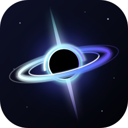
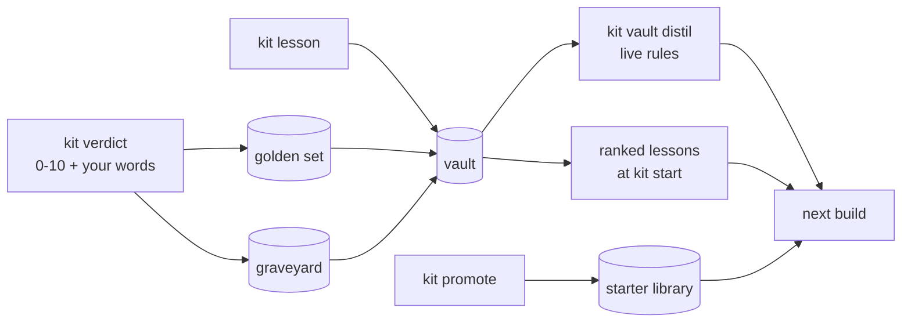

<p align="center">
  
</p>

<h1 align="center">Parallax</h1>

<p align="center">
  <b>Turn your AI coding agent into a Roblox game studio.</b><br>
  Eight production pipelines - 3D, VFX, animation, worlds, UI, sound, gameplay systems and QA - served as an MCP tool,
  with stages that cannot be skipped, gates that measure, and a knowledge vault that learns from every verdict you give.
</p>

<p align="center">
  <a href="https://github.com/mayusi/parallax/actions/workflows/ci.yml"></a>
  <a href="https://github.com/mayusi/parallax/releases"></a>
  <a href="LICENSE"></a>
  
  
</p>

<p align="center">
  <a href="SETUP.md"><b>Setup guide</b></a> ·
  <a href="#how-it-works"><b>How it works</b></a> ·
  <a href="#the-pipelines"><b>The pipelines</b></a> ·
  <a href="#hardware-tiers"><b>Hardware tiers</b></a> ·
  <a href="#how-it-gets-better"><b>How it gets better</b></a> ·
  <a href="#roadmap"><b>Roadmap</b></a>
</p>

---

## What Parallax is

Parallax is an **MCP server and a command-line kit** that an AI agent drives to make a Roblox game: gameplay code,
3D models, visual effects, animations, levels, interfaces, sound and tests. You say what you want; the agent works
through that pipeline's stages; the kit measures every result; **you** give the verdict - and the kit remembers it.

Most AI game tooling is a prompt and a hope. Parallax is built on three different ideas:

- **Enforced, not advisory.** Pipeline work is refused until a lane session is started with your request. Each stage
  unlocks only when the one before it produced its evidence, and the stages that need your eye (a model sheet, a
  blockout, an effect's test frame, an animation's key poses) wait for your approval. The rules live in the tool, not
  in a text file an agent can ignore.
- **Measured, not guessed.** Every pipeline ends in numbers: traced silhouettes against real references, motion
  gates calibrated on Roblox's own animation catalog, effect norms measured from shipped games, R6 reachability on the
  real jump arc, loudness and masking for sound, a security audit for every remote.
- **It learns from you.** Your verdicts (0-10), your approvals and your rejections become the golden set, the
  graveyard and ranked lessons that the next build must answer before it may start.

It is **local-first** (every model and tool runs on your machine, vetted and pinned in [`VETLOG.md`](VETLOG.md)),
**needs no local LLM** (your AI client is the only reasoning model; local vision models are optional
[hardware tiers](#hardware-tiers)), works with **any MCP client**, and is **safe by default**: the server is the
authority in every system it writes, and nothing it uploads leaves without passing its moderation gate.

## Quick start

Full step-by-step instructions - written so an AI agent can follow them for you - are in **[SETUP.md](SETUP.md)**.

```powershell
git clone https://github.com/mayusi/parallax.git
cd parallax
rokit install
wally install
lune run parallax doctor
lune run parallax install ..\MyGame
cd ..\MyGame
lune run parallax connect claude
```

Use your client's name in place of `claude`: `cursor`, `vscode`, `gemini`, `roo`, `opencode`, `codex`, `windsurf`,
`cline` or `claude-desktop`. Then open the client in `MyGame` and ask for something - *"start the 3d lane: a mossy
stone well for the village square"*. The agent calls `parallax_start`, and the lane takes it from there.

## How it works


1. **You ask.** In plain words, in your AI client.
2. **The lane starts.** `parallax_start` (or `lune run parallax start <lane> --prompt "..."`) compiles your words with
   **PROMPT-X** into a repo-grounded brief - up to three clarifying questions, answered from the project where it
   can - and routes it to its **case**: the floor of steps it must take, the routes it may not take, and the points
   where it must stop for you. It loads the lane's boot sheet: its rules, the lessons ranked for this piece, the
   golden set, the graveyard, the open tasks and the last handoff.
3. **Stages unlock in order.** `lune run parallax plan <piece>` shows where a piece is and the next stage's commands.
   A stage's commands refuse to run until the stage before it left its evidence - and, where the lane has a lock,
   your approval (`kit approve`).
4. **Gates measure.** Every build ends with its gates. A failing gate names the fault and the fix.
5. **You look and decide.** The kit shows you the evidence - model sheets, renders, effect players, motion sheets,
   listening booths, look stations beside their references - and records your verdict:
   `kit verdict <kind> <name> <0-10> "<your words>"`.
6. **The kit learns.** The verdict, your words and any lesson flow into the vault and shape the next build.

Every command ends with two lines - `summary:` (what happened) and `next_action:` (exactly what to do next) - so any
model, or you, can always continue. The work board (`kit status`) and handoffs mean nothing lives only in a chat:
switch models or tools and the next one picks up where the last one stopped.

## Enforced, not advisory

The rules hold whatever AI client is on the other end, because they are enforced in layers that do not depend on the
agent reading anything:

| Layer | What it stops | Works with |
|---|---|---|
| **MCP server gate** | a pipeline tool call with no lane session (the refusal names the exact call to make first) | every MCP client |
| **CLI gate** | the same pipeline commands from a shell (exit 6) - including the wrong lane's | any terminal, any agent |
| **Stage locks** | a stage that runs before the previous stage's evidence, or before your approval | every lane |
| **Quality locks** | a new piece with no real source (chart, references, brief, dossier), or a fourth new piece while three wait for your verdict | every lane |
| **Git hooks** | commits that fail format, lint or compile, break a case's contract, or mix two lanes' files | every clone once `install`, `connect` or `harness` has run in it (git never copies hooks) |
| **Client hooks** | direct edits to pipeline files outside a session (Claude Code, Gemini CLI) | clients that run hooks |
| **`verify` and CI** | everything else: types, tests, the security audit, every content gate | everywhere |

Escape hatches exist for real maintenance (`--maintenance "<why>"`, `--skip-tool <tool> --why "<why>"`) and every
use is logged for your review. `lune run parallax selftest` proves the gates themselves: every content gate is run
against a bad fixture it must catch, and a gate that stops catching fails the run.

## The pipelines

| Lane | Makes | Measured by | You approve |
|---|---|---|---|
| [**3D**](#3d-models) `3d` | weapons, props, vehicles, creatures, building pieces | traced silhouettes, section distances, close-up fidelity, budgets | model sheet, blockout, verdict |
| [**VFX**](#visual-effects) `vfx` | ultimates, beams, slashes, explosions, auras | budgets, pro norms, on-screen share, scene match | test frame, animatic, verdict |
| [**Animation**](#animation) `anim` | attacks, abilities, emotes, idles, hit reactions | planted feet, pops, hit timing, readability, collisions | key poses, picks, verdict |
| [**Worlds**](#worlds) `world` | arenas, lobbies, obbies, towns, interiors, terrain | reachability, traps, spawn fairness, sightlines, look lint | direction, verdict |
| [**UI**](#interfaces) `ui` | HUDs, menus, shops, dialogs, status screens | readability, touch targets, size floors, identity bans | direction, verdict |
| [**Sound**](#sound) `sfx` | clicks, hits, explosions, weapons, loops | loudness, clipping, masking, sync to the hit | references, booth verdict |
| [**Systems**](#gameplay-systems) `code` | server-authoritative gameplay code | security audit, tests, fuzzing, mutation score | the brief, accepted floors |
| [**QA**](#qa) `qa` | audits, gate selftests, in-engine playtests | console errors, a performance probe, regressions | the verdicts that become floors |

### 3D models

Game-ready models built in one planned pass, part by part, from real references.

**What it can do**
- Gather real references: picture search, real-object dossiers with graded facts, patents, and two measured
  reference models per asset; local segmentation (BiRefNet, SAM 3) and similarity search (SigLIP 2, DINOv2).
- Draft with local 3D generators (TRELLIS.2, Pixal3D, Hunyuan3D-2mv, PartCrafter) - as look targets, never as the
  final mesh.
- Build hard surfaces with CAD on OpenCASCADE (profiles, fillets, booleans, revolves, sweeps, soft or crisp edge
  roles, a parts library of threads, beads, rings, settings, gems, chains and screws) and organic parts by a
  picture-first route.
- Surface with scanned PBR materials and Blender bakes (normal, colour, roughness, metal), stamps, ornament relief
  from an SVG or PNG, mouldings and contact wear.
- Cloth drapes, mechanisms (joints, an action on a timeline, take-apart views), high/low bakes per part group inside a
  game budget, UVs by part, and CMA-ES auto-fitting of proportions to traced reference views.

**How it works** - brief → gather → model sheet *(you approve)* → draft → blockout *(you approve)* → shape → surface →
mechanism → look & judge → optimize & upload. `lune run parallax plan <name>` unlocks one stage at a time.

**Gates** - every traced view matches its reference (IoU ≥ 0.9) or is excluded with a written reason; hero hard
surfaces stay within 1.5 mm of a reference model's sections; the sheet carries a picture, a sourced size and at least
2 px/mm for every hero feature; close-ups are checked at 2048 px; a prop over its triangle budget fails the build.

**It learns** from its graveyard (a failed route is refused without your word), from ranked lessons a route change
must answer, and from a per-asset study the kit requires before a new piece starts.

**Known limits** - some OpenCASCADE fillets fail silently on traced outlines, and coplanar faces are the commonest
boolean failure; whole-object generator meshes are never accepted for a hero's hard surface.

### Visual effects

Anime- and AAA-grade effects built as layered presets from a measured breakdown of real footage, judged in a browser
player.

**What it can do**
- Break a reference clip down frame by frame - dense timing, camera stabilisation, outline tracing - into a beat chart.
- A register of 104 named effect methods: every beat states which methods it uses, and a planned method that is not
  used fails the build.
- Textures from compositing sheets, ink sheets traced from the reference, and Blender recipes.
- Simulation bakers in Blender: cloth, soft bodies, sand, hair, Geometry Nodes ripples and scatter, water, FLIP and
  PBF liquids, Mantaflow GPU smoke; fracture debris that settles.
- Particles with authored flow fields and point attractors, screen-size forcing, lens flares, chromatic aberration and
  motion-vector inbetweening; mesh shells (flame, tongue, spiral, bolt) and flipbook cards.
- A runtime with one clock for hit-stop and slow motion, composition, EditableMesh shells and a validator.
- A creative director that learns your taste from the vault, and an evolve loop: four variants, you pick.

**How it works** - breakdown → beat chart with one test frame *(you approve)* → method plan per beat → animatic
*(you approve the motion)* → textures → preset → play and record → judge → ship.

**Gates** - validator budgets (layers, particle counts and rates, live particles, light range); pro norms measured
from shipped Roblox effects (share of non-additive layers, lifetimes, front-loaded curves, a dark twin behind every
bright shape, about five colours); the strike holds at least 3% of the hero view before its impact frames; and the
effect must match the scene's coverage, light, colour and detail before a test frame is shown.

**It learns** - every graveyard route becomes a gate on the real piece; the director re-distils your taste after
every verdict; your named faults become selftest fixtures.

**Known limits** - water does not break or spray yet; liquids are flipbook slices; the Mantaflow smoke route is not
yet proven end to end; camera stabilisation fails on flat backgrounds.

### Animation

Measured R6 animations authored from scratch on a procedural spring engine, calibrated against Roblox's native R6
catalog and proven in Studio frame by frame.

**What it can do**
- Move dossiers with measured phase timings; offline footage analysis (MediaPipe Pose) for timings, foot speed, hip
  and chest turn, pivot and lean.
- A procedural engine - beat script → gesture specs → pose prior → spring engine at 60 fps - with effort sliders, arm
  habits, whip and blade planes, and an intent (calm, proper, aggressive) read from catalog tempo.
- Weapon movesets (one- and two-handed), physics hit reactions (MuJoCo), animated props with joint ranges.
- Blocking sheets of key poses, a design page for attack strings, timing charts, and gallery tuning: about 2.5×
  gate-clean candidates are built, the eight most different are shown, and your picks steer the next round.
- Repairs (grip solve, collision repair, foot planting, gap filling) and animated glTF export.
- A runtime: inertialization, additive layers, motion warping, matching tables, foot placement, ragdoll get-up,
  secondary motion, cutscenes and look-at.

**How it works** - dossier → design (attack strings) → blocking *(you approve)* → candidates → gates → your picks →
Studio proof → verdict.

**Gates** - planted feet (skate under 0.1 studs per frame), pops and seams, the hit on the striker's fastest frame,
readability, no statues, floaty or robotic arms, no jitter or frozen limbs; the weapon stays in hand; weapon, hands and
feet are swept against the body for collisions.

**It learns** - your picks and rejections steer the next gallery; the golden set is the calibration source; rejected
clips become gates; a dossier must answer a rejection before a rebuild.

**Known limits** - no locomotion start, stop or pivot clips yet; no steering by player input; no runtime prop player;
Roblox samples animation curves at 30 per second, so a 60 fps clip loses its odd frames.

### Worlds

Levels and maps built from JSON blueprints by generators, proven playable by numbers and walked in Studio.

**What it can do**
- Typed generators: rooms, buildings, stairs, cover, paths, breakables, walls, rings, scatter, forests, ruins,
  towers, bridges, trees, palisades, peaks, dunes, cities, crosswalks and rows.
- A town planner: square, streets, terraced lots on a 4-stud grid, a landmark sightline and house types.
- Terrain shaped by rivers (stream-power incision), thermal and droplet erosion, a heightmap painter with keep masks,
  and real elevation data.
- Scanned CC0 materials, mesh import split to the engine's limits, and streaming per step with far stand-ins.
- Creative direction (intent, references from several media, pillars, three directions with frames), measured
  references (horizon, value structure, haze, palette, landmark placement), and look stations: every spawn and view
  rendered at 1920×1080 beside its reference.

**How it works** - direction *(you pick)* → references → lessons → terrain → materials → meshes → dressing → check →
look → Studio walk → verdict.

**Gates** - R6 reachability on the real jump arc, traps, spawn fairness, camera clearance, knockback room and
sightlines; a look lint for floating or buried props, trees inside buildings and rocks on roads; town rules (no
freehand town of twelve or more buildings, declared curves and rooms); streaming required past 1,024 studs.

**Known limits** - coloured light on water turns muddy; yards, markets and lamps are checked for presence, not yet for
quality.

### Interfaces

HUDs, menus, shops, death screens, status sheets and dialogs that share one identity - compiled to Rojo models,
previewed at phone, tablet and desktop sizes with the real fonts, and animated by the kit's UI runtime.

**What it can do**
- Three to five original design directions before any screen; an identity pack sampled from real references
  (tokens, a font trio, shape language, motion rules and bans).
- Pieces rendered, traced, inked, lettered or spun - never a tinted font glyph standing in for art.
- Assembly from anchors, HUD size contracts measured at real screen sizes, and motion reels.
- A runtime with springs, choreographed entrances, bar ghosts and rolling counters.

**How it works** - direction *(you pick)* → identity → pieces → assembly → look (sheet and reel) → two fresh reviewers
hunt bugs → your verdict.

**Gates** - the identity's bans, HUD size floors, readability, touch targets and the usual tells of generated UI.

**Known limits** - taste is yours: the model's own judge rates it lower than people do; Roblox caps text size at 100
and has no letter-spacing.

### Sound

Sound effects made from real recordings layered with synthesis, in sets that share one sonic DNA, judged by you in a
listening booth and played as events by the kit's sound runtime on the Audio API.

**What it can do**
- Three directions that differ in space, source, density or mood; an identity measured from references you pick.
- Layered design (transient, body, sub, mechanical, tail, sweetener, air) and sets with shared DNA, weights and one
  loudness per class.
- Matching against a reference, sound sheets the agent can read, an audio-video sync gate, and living ambience
  (wind voices, gusts, echo zones).

**How it works** - direction → references *(you pick, in the booth)* → identity → design → match → sheet → booth
verdict → sync to the hit → runtime events → upload.

**Gates** - format, size, duration, loudness and clipping; layers that mask each other; Roblox's upload limits.

**Known limits** - the model cannot hear: numbers against a reference are its only evidence, so a sound is never
judged alone, and real recordings beat pure synthesis.

### Gameplay systems

Server-authoritative Roblox code: the game skeleton, systems with pure tested rules, remotes generated from schemas,
and combat moves as data.

**What it can do**
- `kit game new <Name>` - a game folder with its brief, source, work board and Rojo project.
- `kit new system <Name>` - a Config, pure Rules, a Service, a Controller and a spec.
- `kit net` - type-safe, rate-limited, argument-validated remotes generated from a schema.
- `kit move` - moves as data (frames from the animation, hitboxes, cancels) served by a server hit loop.
- Fuzzing, mutation testing (at least 80% of mutants killed) and playtests driven in Studio that fail on any console
  error.

**How it works** - brief → world → systems → remotes → moves → playtests → accept (a verdict of 7 or more becomes a
floor that may not regress).

**Gates** - the security audit (every remote argument validated and rate-limited; `require(<id>)`, `loadstring` and
`getfenv` flagged as backdoors); format, lint, types and tests; shared modules stay pure.

**Known limits** - green specs are not a working game: the engine proves it, in playtests.

### QA

Testing like a tester: security audits, gate selftests, scripted in-engine playtests with a performance probe, and a
regression record.

**What it can do**
- `kit audit` - unvalidated or unthrottled remote handlers, backdoor patterns, broadcasts in loops.
- `kit selftest` - every content gate must catch its bad fixture.
- `kit playtest` - drives Studio over its MCP server: play, inject the test, collect the console, stop. Any console
  error fails; a performance probe checks your budget.
- `kit bug` - every bug becomes a spec and a mutation case; `kit accept` turns your verdicts into floors.

**Known limits** - Studio is shared between sessions (the kit checks its state first), and an unfocused Studio window
renders at a few frames per second.

## How it gets better



- **Verdicts** - `kit verdict <kind> <name> <0-10> "<words>"` is the only quality signal. A score of 7 or more puts the
  piece in the golden set; 3 or less puts its route in the graveyard, and that route is refused next time unless you
  say otherwise. A judge's score or a green gate is never counted as progress on the look.
- **Lessons** - `kit lesson <area> "..."` records a technique or a trap. `kit start --for <piece>` ranks the lessons
  that matter for the piece about to be built, and a new piece must answer them before its quality locks pass.
- **Rules** - after five new verdicts `kit start` announces a distil: `kit vault distil <lane>` turns the evidence into
  live rules you can add, edit or retire.
- **Taste** - the VFX and UI directors and the lanes' checks re-learn from every verdict automatically.
- **Prompts** - `kit prompt evolve` feeds a verdict back into the prompt that produced the piece, and `kit prompt
  bench` replays real failed prompts so each keeps its guardrail.
- **Examples** - `kit promote <kind> <name>` adds proven work to the starter library; `lune run parallax sync` brings
  the kit's lessons and examples into every game.

The vault (`kit/knowledge/vault`) is plain Markdown with YAML front matter and wikilinks - readable in Obsidian, but
the kit never depends on it.

## Use it from any AI client

Parallax is an MCP server (`kit/mcp/server.py`, Python standard library only). It carries its own rules - sent to the
client as the server's instructions - and every lane's full recipe, so **no client needs an instruction file, a rules
folder or a copy of the skills**. `lune run parallax connect <client>` adds the server to the client you use, and only
that one:

| Client | Command | Writes |
|---|---|---|
| Claude Code | `connect claude` | `.mcp.json`, plus `.claude/settings.json` with the enforcement hooks |
| Cursor | `connect cursor` | `.cursor/mcp.json` |
| VS Code (Copilot agent mode) | `connect vscode` | `.vscode/mcp.json` |
| Gemini CLI | `connect gemini` | `.gemini/settings.json`, with the enforcement hooks |
| Roo Code | `connect roo` | `.roo/mcp.json` |
| OpenCode | `connect opencode` | `opencode.json` |
| Codex CLI · Windsurf · Cline · Claude Desktop | `connect codex` (and so on) | nothing - prints the block to paste into the client's global config |

`connect` with no client lists them and shows what is connected; `connect <client> --remove` takes the kit's entry out
again. The tools every client gets:

| Tool | What it does |
|---|---|
| `parallax_start` | **Start here.** Loads one lane; with your request, PROMPT-X compiles it and opens the session that unlocks pipeline work |
| `parallax_prompt` | Compiles a request with PROMPT-X (cases, golden and graveyard records, a token budget per model) |
| `parallax_case` | The case a request falls in: its floor, forbidden routes, your stops and the lane's capability menu |
| `parallax_skill` | The lane's full recipe: every stage, its commands, its traps and its case table |
| `parallax_status` | The whole board: brief, tasks, the last handoff, failing gates and the next step |
| `parallax_verify` | The full quality gate |
| `parallax_help` | Every command |
| `parallax` | Runs any command; pipeline commands are refused without a session |

Clients that show MCP prompts as slash commands also get `start-<lane>` prompts.

## Uploads without an API key

`lune run parallax upload` puts everything a game needs on Roblox and records the ids where the game reads them:
textures, models and their maps, effect meshes, world meshes, interface art, sounds and animations. Only new or
changed files go, and every file is screened first by the moderation gate (banned words, blood). Then the
**Roblox Studio MCP** sends them with your own Studio login - `upload` hands the agent the exact `open_cloud_invoke`
call for each file, and `upload --record <file> <assetId>` stores each id. No key is created, typed or stored. In
Studio you grant the scopes once, per game (see [SETUP.md](SETUP.md#step-6--roblox-studio-and-its-mcp-server)).
For headless runs (CI, no Studio), an `ROBLOX_API_KEY` in the environment still works.

## Commands you will use

`kit` is short for `lune run parallax` (`lune run kit` is the same command).

| Command | What it does |
|---|---|
| `lune run parallax status` | the board: brief, tasks in progress, last handoff, failing gates, next step |
| `lune run parallax start <lane> --prompt "<request>"` | starts a lane session (the same as `parallax_start`) |
| `lune run parallax plan <piece>` | where a piece is, and the next stage's commands |
| `lune run parallax approve <lane> <name> "<words>" --by owner` | records your approval of a locked stage |
| `lune run parallax verdict <kind> <name> <0-10> "<words>"` | records your verdict |
| `lune run parallax verify` | the full quality gate |
| `lune run parallax selftest` | proves every gate still catches its bad fixture |
| `lune run parallax upload` | screens and uploads new or changed assets |
| `lune run parallax handoff "<what>" --lane <lane> --next "<what next>"` | ends a session for the next model or person |
| `lune run parallax connect <client>` | connects an AI client |
| `lune run parallax doctor` | checks every tool and reports your machine's hardware tier |
| `lune run parallax vision setup [--tier core\|vision\|gen\|all]` | fetches the vetted local models for a tier (`--list` shows sizes) |
| `lune run parallax upgrade [--check]` | updates the kit in a game from the latest GitHub release |
| `lune run parallax help --all` | everything else |

## Hardware tiers

Parallax runs on any PC and grows with your hardware. Each tier includes everything below it, and the kit degrades
gracefully: a missing tier never breaks a lower one - the lane takes the route that tier allows and says so.
`lune run parallax doctor` tells you which tier your machine reaches and exactly what the next one needs.

| Tier | Hardware | Add | Disk · VRAM · RAM | Unlocks | Without it |
|---|---|---|---|---|---|
| **0 · Zero-GPU core** | any Windows PC, no GPU | Rokit's toolchain, Python 3.11 (numpy, scipy, Pillow, matplotlib, pytest), Node.js, ffmpeg | < 0.5 GB · none · 4 GB | PROMPT-X, the board and gates, `verify` / `test` / `selftest`, the security audit, gameplay systems and remotes, the UI compiler, sound synthesis and its booth, world checks, uploads, Studio playtests | - |
| **1 · DCC & CAD** | any CPU, or an entry GPU | Blender 5.2, then `tools setup kit-python`, `tools setup cad`, `tools setup mitsuba` | ~2 GB · 0-2 GB · 8 GB | 3D modelling (CAD, procedural, bakes), Cycles renders, UI 3D plates, animation bakes, world look stations | CAD and procedural geometry only; no ML cut-outs or generation |
| **2 · Light vision core** | the CPU (`KIT_FORCE_CPU=1`) or any 4 GB GPU | `vision setup` - the core models (SAM 2.1, Depth Anything V2, BiRefNet, TEED, SigLIP 2, DINOv2, Real-ESRGAN) | 2.4 GB · 0-4 GB · 8-16 GB | cut-outs, depth, edges, similarity search, traced references, part masks by point or box, 4× upscaling | point/box masks instead of text prompts; your AI client reads what a local VLM would |
| **3 · Local VLM & diffusion** | an NVIDIA GPU with 12 GB, 16 GB RAM | `vision setup --tier vision` (Qwen3-VL, Depth Anything 3, MoGe-2, Marigold, SDXL lighting, FLUX.2 klein, SAM 3) | +44.6 GB · 12 GB · 16 GB | local reference reading, relief / normal / albedo from photos, HDRI lighting probes, concept and plate generation | SAM 3 is skipped without `HF_TOKEN`; without the VLM the kit hands your AI client a packet to judge |
| **4 · Full 3D generation** | CUDA 13, 12-16+ GB VRAM, 32 GB RAM, Windows + MSVC 2022 | `vision setup --tier gen` (Qwen-Image-Edit + its runner) and the 3D generators' environments ([`kit/gen/README.md`](kit/gen/README.md)) | +25-70 GB · 12-16 GB · 32 GB | single- and multi-view 3D drafts (TRELLIS.2, Pixal3D, Hunyuan3D-2, PartCrafter), new-angle image edits, photogrammetry, retopology, convex hulls | lower tiers build with CAD, procedural scripts and vetted CC0 meshes |

`lune run parallax vision setup --list` prints every model with its tier and size. The Tier 4 generators are strictly
opt-in and each comes under its own licence (some restrict territories or uses - read [`VETLOG.md`](VETLOG.md) before
installing one). [SETUP.md](SETUP.md#step-5--choose-your-hardware-tier) walks through each tier.

### Optional services

Nothing here is required; each one only switches a feature on.

| Service | How | Without it |
|---|---|---|
| Roblox Studio's MCP server | Studio's own settings (no key) | no playtests or uploads; every offline compiler and gate still runs |
| Hugging Face gated models (SAM 3, DINOv3) | your own access + `HF_TOKEN` in your environment | the free SAM 2.1 point/box masks stand in; the Tier 4 encoder is not fetched |
| Sketchfab reference models | `SKETCHFAB_API_TOKEN` | search still works; downloads fall back to Poly Haven, Smithsonian and ambientCG |
| Public reference sources (Openverse, Wikimedia, museums, Poly Haven, USGS, ...) | none | a tool that cannot reach one skips it with a structured note |
| Headless uploads (CI) | `ROBLOX_API_KEY` in the environment | uploads go through the Studio MCP instead |

There are no cloud AI APIs anywhere in the kit: your AI client is the only reasoning model. Where a local VLM would
judge something - a design review against its bans and pillars, screening a design exploration's candidates against
the bans, reading the text in a reference - and Tier 3 is not installed, the kit hands your AI client a packet instead
(the pictures, a `PROMPT.md` with the exact questions) and records its answer with `--record`, so no lane needs a local
VLM. Until the answer is recorded, nothing unscreened moves on (an exploration writes no direction sheet).

## Project layout

```
parallax/
├── kit/                 the kit: commands (cmd/), libraries (lib/), Python tools, the MCP server (mcp/),
│                        lane recipes (skills/), cases and the knowledge vault (knowledge/), selftest fixtures
├── src/kit/             the in-game runtime your game requires (VFX, UI, sound, animation, worlds, networking)
├── assets/              the measured data the builders read (animation calibration, the R6 rig, effect norms)
├── parallax.luau        the entry point: lune run parallax <command>
├── rokit.toml           the pinned toolchain       wally.toml / wally.lock   the pinned packages
└── docs/                the logo and documentation assets
```

`lune run parallax install <path>` copies the kit into a game folder. To keep it current, `lune run parallax upgrade`
(inside a game) installs the latest GitHub release - SHA-256 checked, backed up first, and in four zones: the kit's code
is replaced (files you added under `kit/` stay), starter content and lessons are only added to, the knowledge vault is
merged with your own lessons and verdicts kept, and your game's code and content are left alone - the new kit's `init`
only keeps its own lines in `.gitignore`, the git hooks and a connected client's config in step. From a local clone,
`lune run parallax sync` (inside a game) or `lune run parallax update <path>` (here) copies the kit in from your clone
instead - your clone is the source, so there is no download, checksum or backup, and kit files a newer version
dropped are left in place. Neither takes a game back to an older kit than the one it holds unless you add `--force`.

## Roadmap

Parallax keeps growing in the open. Planned, in no fixed order:

- **Other engines - Godot first, then Unreal Engine and Unity.** About 70% of the kit is already engine-agnostic, and
  much of what the pipelines make is engine-neutral (FBX and glTF models, baked PBR maps, glTF animation, OGG sound).
  Each engine gets nine drivers - assets, scenes, animation, materials, audio, the engine bridge, code, publishing and
  a runtime SDK - behind the same MCP server and gates; a project already names its engine in `kit.config.json`
  (`"engine": "roblox"`). The architecture: [docs/ENGINES.md](docs/ENGINES.md).
- **macOS and Linux** as first-class platforms.
- **A one-step install** of the MCP server.
- **The known limits above:** locomotion clips and input steering, water that breaks and sprays, a proven smoke
  route, a runtime prop player, quality checks for town dressing.
- **Shared knowledge:** opt-in syncing of lessons and golden sets between projects and teams.
- **A documentation site** with every lane's full recipe.

Ideas and requests are welcome in the issues.

## Status

**v3.1.0** is the current release (November 2026), Windows first. The kit's own tests: 1,900+ Luau specs, 5,000+
Python tests, and a selftest in which every content gate must catch its bad fixture.

## Contributing, security and license

- How to work on the kit itself: [CONTRIBUTING.md](CONTRIBUTING.md). Changes: [CHANGELOG.md](CHANGELOG.md). Why
  things are this way: [DECISIONS.md](DECISIONS.md).
- Security model and reporting: [SECURITY.md](SECURITY.md). Every tool, model and dataset the kit downloads is
  double-vetted in [VETLOG.md](VETLOG.md).
- MIT - see [LICENSE](LICENSE). Copyright (c) 2026 mayusi. Third-party components keep their own licences:
  [THIRD_PARTY_NOTICES.md](THIRD_PARTY_NOTICES.md).

Parallax is an independent project and is not affiliated with or endorsed by Roblox Corporation.
